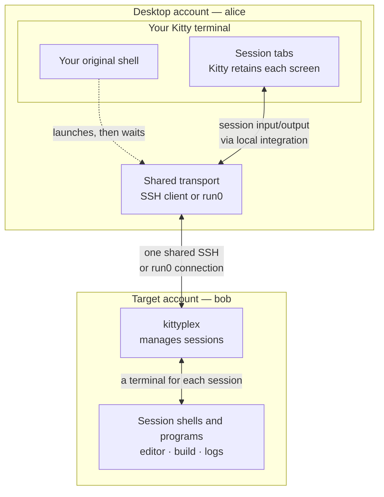

# kittyplex

> Experimental proof-of-concept. Kittyplex is an exploration of a different
> terminal-multiplexing architecture. 

## Introduction

Kittyplex lets you create several terminal sessions in a remote account, or as
another user on your own computer, using Kitty's native tabs and split panes.
You might keep an editor, a build and a log viewer open together without
starting a separate SSH login or user-switching command for each session.

The experiment is to separate **running programs** from **displaying their
terminals**. Kittyplex manages the shells and applications in the target account.
Your local Kitty terminal maintains each session's screen, scrollback, cursor and
terminal modes. Switching tabs selects a screen that Kitty has kept up to date;
the application continues running in its own session while you look elsewhere.



With **SSH**, the target account is on another computer. With **run0**, it is
another account on the same computer. In both cases, Kitty runs as the local
user, and the applications run as the target user. The overview hides the local
routing processes; the [detailed diagram](#how-it-fits-together) expands them.
The original shell and the session shells are separate processes.

### How does it differ from tmux

[tmux](https://github.com/tmux/tmux/wiki/Getting-Started) is a general-purpose
terminal multiplexer with a client/server architecture. Its server manages the
programs and their terminal state, and clients can detach and later reattach
through different terminals. To do this, it acts as a terminal emulator in its
own right, which in effect creates a stack of terminal emulators between the
process and the screen. This also means that many of kitty's advanced features
are not available when using tmux. 

Kittyplex explores a different division of responsibility: manage the programs
in the target account, but let Kitty itself own and render their terminal
screens. Kittyplex transports application bytes without implementing another
terminal emulator. This makes Kitty's native display handling part of the design,
with its own setup requirements and compatibility limits. The current prototype
requires Kitty and a live connection, has no detach/reattach support, and is not
a drop-in replacement for tmux.

This approach intends to enable more of kitty's native functionality to work
also remotely, such as the graphics protocol. 

## Main use cases

These examples assume the [local Kitty integration](#install) is configured and
kittyplex is installed where it will run, both in the local and remote location.
To explore it without changing your installed configuration, start with the
[isolated demo](#try-the-proof-of-concept).

### Work on a remote server through one SSH connection

Connect as bob and start a session group on the server:

```sh
kittyplex ssh bob@server
```

Create separate sessions for an editor, a build and a log viewer. Their programs
run on the server as bob; each display has its own local Kitty pane, initially
in a separate tab. Additional
sessions share the original SSH connection instead of starting another login.
Keep the original connection's carrier tab open while working.

You can also begin from an ordinary SSH login:

```sh
ssh bob@server
kittyplex
```

### Work as another user on the same computer with run0

While using your desktop as alice, start a session group as bob:

```sh
kittyplex run0 -u bob --pty
```

Complete the normal authentication prompt. The target sessions use bob's home
directory and configured login shell. You can create more sessions as bob while
Kitty remains part of alice's desktop; switching sessions does not require
starting another run0 command. Quitting the group returns to alice's original
shell. Run0 without `-u` targets root.

### Keep several sessions under your current account

For the same arrangement without SSH or a user change:

```sh
kittyplex start
```

It starts in your current directory.

## Keyboard shortcuts

Press **Ctrl-Shift-M**, release it, then press the action key:

| Key | Action |
| --- | --- |
| `t` / `c` | Create and select a session in a new tab |
| `v` | Vertical split: new session on the right |
| `h` | Horizontal split: new session below |
| `w` | Close this pane and its session |
| `?` | Show help; Escape dismisses it |
| `n` / `p` | Next / previous session |
| `1`–`9` | Select an existing session by its current position in the group |
| `q` | Close the entire group and its sessions |

Escape cancels management mode. Pressing **Ctrl-Shift-M** twice sends one literal
Ctrl-Shift-M to the application. Shortcuts apply only inside managed views;
ordinary Enter/Ctrl-M remains application input. Kitty's native tab selection
also works. Numbered shortcuts follow session creation order; reordering Kitty
tabs does not change their numbering.

Help opens a local overlay over the focused pane; the session keeps running
underneath. Use Kitty’s own controls to resize and rearrange split panes.

See the [usage guide](docs/usage.md#controls-and-lifecycle) for complete behavior
and prefix customization.

## How it fits together

This diagram follows **`kittyplex ssh bob@server` from an ordinary local shell**.
Screen and integration boxes inside Kitty are objects/code in one Kitty process.
The shell, SSH client, broker, relays, controller and applications are separate
processes. A **PTY** is an operating-system terminal connection; it carries bytes
and terminal behavior, and does not draw a screen.

```mermaid
flowchart TB
    subgraph local["Desktop account: alice"]
        subgraph kitty["One Kitty process"]
            integration["Kitty control dispatch<br/>and kittyplex Python integration"]
            carrier["Original carrier screen"]
            screen1["Session 1 screen"]
            screen2["Session 2 screen"]
        end
        shell["Your original shell process<br/>started by Kitty"]
        client["SSH client process"]
        broker["Local broker<br/>kittyplex __broker"]
        relay1["Session 1 relay<br/>kittyplex __view"]
        relay2["Session 2 relay<br/>kittyplex __view"]
        shell -.->|"launches, then waits"| client
        integration -.->|"starts"| broker
        integration -.->|"starts"| relay1
        integration -.->|"starts"| relay2
        carrier <-->|"carrier PTY"| client
        carrier <-->|"framed carrier messages"| integration
        integration <-->|"private control FD<br/>and local datagrams"| broker
        broker <-->|"local socket"| relay1
        broker <-->|"local socket"| relay2
        relay1 <-->|"view PTY 1"| screen1
        relay2 <-->|"view PTY 2"| screen2
    end
    subgraph server["Remote computer"]
        sshd["SSH server worker"]
        subgraph account["Target account: bob"]
            manager["Kittyplex controller"]
            session1["Session 1 shell"]
            session2["Session 2 shell"]
            editor["Editor process"]
            logs["Log viewer process"]
            manager -.->|"starts"| session1
            manager -.->|"starts"| session2
            pty1["Application PTY 1<br/>kernel terminal"]
            pty2["Application PTY 2<br/>kernel terminal"]
            manager <-->|"master"| pty1
            manager <-->|"master"| pty2
            pty1 <-->|"slave"| session1
            pty2 <-->|"slave"| session2
            pty1 <-->|"inherited slave"| editor
            pty2 <-->|"inherited slave"| logs
            session1 -.->|"launches"| editor
            session2 -.->|"launches"| logs
        end
        sshd -.->|"starts target command"| manager
        sshd <-->|"target carrier PTY"| manager
    end
    %% Extra link length keeps the account groups separate when rendered.
    client <------>|"one encrypted SSH connection"| sshd
```



**Dashed arrows** show process launches; **solid arrows** show bidirectional
communication. Shells and their foreground programs use the same application
PTY; a shell waits while its foreground program runs. The numbered relays route
each session's bytes to its corresponding Kitty screen;
all sessions share the carrier connection. The local broker's private Kitty
control capability stays on alice's computer.

For automatic SSH startup, target login initialization replaces itself with the
controller; it is not an extra persistent shell in this diagram. SSH's actual
connection-handling process ancestry can vary. When you instead start kittyplex
from an existing remote shell, that shell waits for the controller to finish.

For **run0**, the SSH client/server transport is replaced by a local run0 client
and a systemd-started service as bob. Both account boundaries are on the same
computer: Kitty, its integration, broker and relays still run as alice; the
controller, application PTYs, shells and applications run as bob. Systemd starts
the target service after normal authorization. The same screen/session routing
applies. The [process guide](docs/how-it-works.md) expands the individual input,
output and startup paths.

## Prototype status and limits

The current prototype has the following practical boundaries:

- **Linux and Kitty-specific.** The desktop needs the local binary and Kitty
  integration files. SSH targets need a compatible binary and `xterm-kitty`
  terminfo; kittyplex does not upload them automatically.
- **No detach or reattach.** Keep the carrier connection and Kitty process open.
  Connection loss ends the group; do not rely on application survival.
- **Up to eight sessions per group.** Sessions retain their state while connected,
  including when another tab is selected.
- **Performance is experimental.** The original-terminal carrier adds framing
  overhead. Hidden output is preserved with backpressure, so a slow display can
  block its applications.
- **Compatibility is bounded by testing.** Using Kitty's own renderer is not a
  promise that every Kitty feature or application workflow works. See the
  [feature audit and limitations](docs/kitty-compatibility.md).

## Try the proof-of-concept

From a graphical Linux desktop with Nix and flakes enabled, in a checkout:

```sh
./scripts/demo.sh
```

The demo opens a separate Kitty process and temporary localhost SSH server,
without modifying your installed Kitty/SSH configuration or system services.
Follow the [interactive walkthrough](docs/usage.md#interactive-walkthrough) to
try switching, Vim, job control and cleanup. The
[graphics demo](docs/usage.md#kitty-features-and-graphics) exercises images and
other Kitty features. This is a local experiment using real SSH, not evidence
of performance on a distant server.

## Install

To integrate the prototype into an existing desktop, choose how to configure Kitty:

| Setup | Instructions and example |
| --- | --- |
| Kittyplex's NixOS/Home Manager modules | [Module setup](docs/integration-instructions.md#install-with-nixos-and-home-manager) |
| Standard NixOS/Home Manager options, without kittyplex modules | [Explicit Nix setup](docs/integration-instructions.md#explicit-nix-configuration-without-kittyplex-modules) |
| Your existing `kitty.conf`, with or without Nix | [Manual Kitty setup](docs/integration-instructions.md#manual-kitty-configuration) |

For source builds, see [building from source](docs/integration-instructions.md#building-from-source).
Start a fresh Kitty process after installation and run `kittyplex doctor` to
check the local integration. `kittyplex COMMAND --help` gives a short command
summary; `man kittyplex` is the full reference. From a checkout, use
`man -l docs/kittyplex.1`.

## Read more

| Question | Reference |
| --- | --- |
| How do I install, configure or troubleshoot it? | [Integration instructions](docs/integration-instructions.md) |
| How do I start and manage sessions? | [Usage guide](docs/usage.md) and [kittyplex(1)](docs/kittyplex.1) |
| Which processes and PTYs communicate, and how? | [How kittyplex works](docs/how-it-works.md) |
| Which Kitty features have been tested? | [Compatibility and validation](docs/kitty-compatibility.md) |
| What are the wire protocol and failure contracts? | [Carrier reference](docs/original-terminal-carrier.md) |
| How do I build, test or benchmark changes? | [Development guide](docs/development.md) |

The [architecture analysis](docs/remote-session-architecture.md) is historical
design research. The [detach analysis](docs/detach-analysis.md) records deferred
options; neither document promises additional implemented features.
