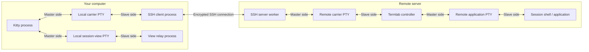
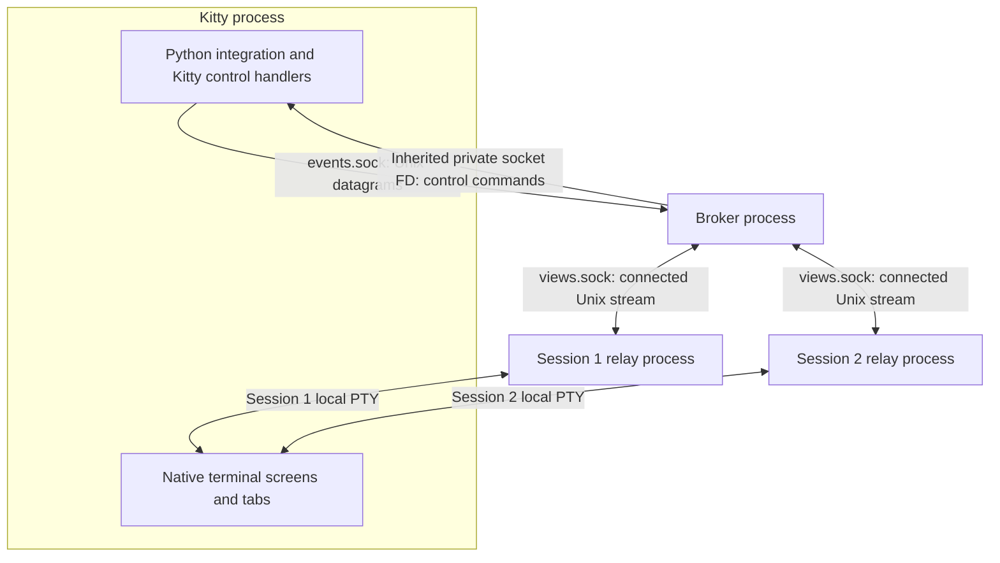
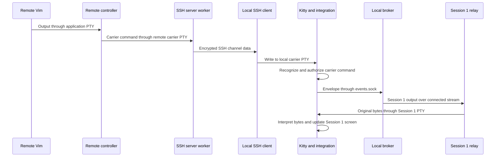
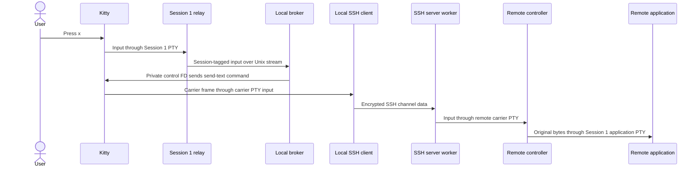
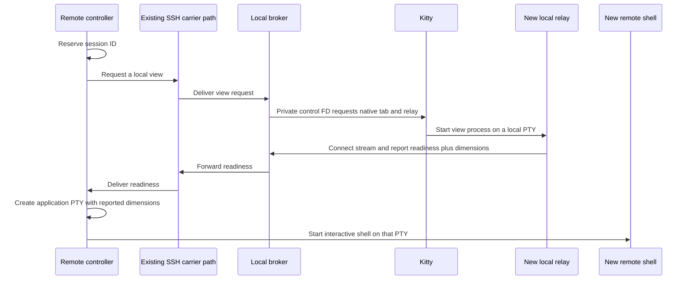

# How termlab works

Kitty remembers what each session looks like. Termlab keeps each session's
programs running on the server. One existing SSH connection carries their
traffic. Switching tabs selects an existing Kitty screen while the other
applications keep running and updating their own screens.

This guide explains the running system, from the visible tabs to the individual
processes and connections. For practical commands, start with the
[README](../README.md). For exact interfaces, wire formats and limits, use the
[carrier reference](original-terminal-carrier.md). The
[compatibility reference](kitty-compatibility.md) records what has been tested;
the [architecture analysis](remote-session-architecture.md) preserves requirements
and the alternative designs considered before implementation.

## 1. What the tabs represent

```text
Your Kitty window
┌─────────────────────┬──────────────────┬──────────────────┐
│ Original SSH tab    │ Session 1: vim   │ Session 2: shell │
│                     │                  │                  │
│ Carries the shared  │ An independent  │ An independent  │
│ SSH connection      │ Kitty screen    │ Kitty screen    │
└─────────────────────┴──────────────────┴──────────────────┘
```

The original SSH tab stays open as the **carrier**: the terminal through which
all sessions communicate with the server. Each additional session gets a native
Kitty tab containing a small local relay connected to a remote application
session. A tab is a user-interface object inside Kitty, not another Kitty process.

Vim stores your document and editing state on the server. Kitty stores how Vim's
terminal screen currently looks on your computer. These are different kinds of
state, with different owners.

| Term | Meaning in this system |
| --- | --- |
| Process | A running program, such as SSH, Bash, Vim, or a termlab relay |
| Terminal emulator | The program that interprets terminal output as text, colors, cursor movements, images and other screen behavior; Kitty performs this job |
| Shell | A program such as Bash that reads commands and starts other programs |
| PTY | A pseudoterminal: an operating-system connection that provides terminal input/output and behavior such as job control; it does not draw a screen |
| Socket | A connection used by processes to exchange data; a Unix-domain socket connects processes on the same machine |
| File descriptor | A process's handle to an open resource, such as a PTY or socket |
| Session | One remote application PTY and its shell/application, connected to one local Kitty view |
| Group | The sessions managed by one remote termlab controller and its shared carrier |

## 2. Which processes run where

One termlab executable serves several roles. Arguments select the role; you
normally start the controller and the integration starts its local counterparts.

| Invocation | Location | Responsibility |
| --- | --- | --- |
| `termlab` | Server | The controller: creates application PTYs and shells, manages sessions, and multiplexes traffic |
| `termlab __broker …` | Your computer | The broker: routes traffic between the Kitty integration and the session relays |
| `termlab __view … SESSION_ID` | Your computer, one per session | A relay: transfers bytes between its local terminal and the broker |
| `termlab ctl …` | Usually the server | A short-lived management client; it is not needed for ordinary typing or output |

For two sessions, a typical process arrangement is:

```text
YOUR COMPUTER
└─ kitty
   ├─ Original carrier terminal
   │  └─ local shell
   │     └─ ssh server
   ├─ Background process
   │  └─ termlab __broker ...
   ├─ Session 1 terminal, in its own tab
   │  └─ termlab __view ... 1
   └─ Session 2 terminal, in its own tab
      └─ termlab __view ... 2

REMOTE SERVER
└─ sshd connection-handling process(es)
   └─ original remote login shell
      └─ termlab
         ├─ session 1 shell
         │  └─ vim
         └─ session 2 shell
            └─ build / other foreground program
```

The terminal/tab labels show where processes are attached; those labels are not
processes themselves. This is typical ancestry, not a universal `ps` listing:
shells can replace themselves with commands, and SSH's worker structure varies.
The important distinction is that the local relay is not the remote shell. The
broker does not run the remote applications.

The original remote login shell waits while its `termlab` command runs. When the
controller exits normally, that shell resumes and gives you your original SSH
prompt. Each managed shell is a separate child of the controller, with its own
application PTY and job-control context.

The Python integration is code running **inside Kitty**, not another persistent
Python server. Its no-UI kitten handlers and watchers receive callbacks from
Kitty. They create/select views and hand messages to the broker; they do not run
the bulk transfer loop. Those loops live in the Rust controller, broker and relays.

## 3. The PTYs connecting terminals to processes

An ordinary interactive SSH login already has two PTYs: a local one connecting
Kitty to the SSH client, and a remote one connecting SSH's server side to the
login shell. Termlab adds a local view PTY and a remote application PTY for each
session.

This diagram shows PTY ownership and the SSH connection. The broker's sockets are
shown separately in the next section. Boxes labeled PTY are kernel objects,
not processes.



A PTY has a master end and a slave end. The application uses the slave as its
terminal. When it writes output to the slave, the master receives those bytes.
When the master writes input, the application can read it from the slave.
The kernel also supplies terminal settings, foreground process groups and size
information through the PTY.

The remote controller holds each application PTY's master end. Its shell and
applications use the slave for standard input, standard output and standard
error. Locally, Kitty holds each view PTY's master end and the relay uses its
slave terminal. The remote carrier PTY is distinct from every application PTY.

For two sessions there are six relevant PTY pairs: the local and remote carrier
PTYs, two local view PTYs, and two remote application PTYs. The broker needs no
terminal of its own.

## 4. Local IPC and the private Kitty connection

**IPC**, or interprocess communication, is how the local processes exchange data.
There are three connections with different jobs:



| Connection | Traffic |
| --- | --- |
| Kitty to broker, `events.sock` | Received carrier envelopes and management/focus/close events |
| Broker to Kitty, inherited private socket | Commands to create/select/clean up views or insert carrier bytes into the original terminal's input |
| Broker to/from each relay, `views.sock` | Session output, input, resize, credit and lifecycle messages |

The named sockets are local Unix-domain sockets, not network ports or
SSH-forwarded sockets. `events.sock` uses datagrams: each send carries one bounded
message. The integration makes a nonblocking send and returns to Kitty rather
than waiting on a large transfer. `views.sock` is a stream listener: each relay
connects to it and gets its own bidirectional stream. Stream messages are
newline-delimited JSON, a text format for structured data.

For the private connection, Kitty creates a socket pair when it launches the
broker and passes one already-open end to that child process. An environment
variable, `KITTY_LISTEN_ON=fd:N`, identifies the inherited file descriptor. The
connection is bidirectional, although the diagram emphasizes the commands the
broker sends. No public Kitty socket is needed.

That descriptor gives the local broker control capabilities which are not
forwarded to the server. Terminal-origin requests instead pass through the
scoped authorization callback. The exact restrictions are in the
[authorization contract](original-terminal-carrier.md#authorization-and-configuration).

## 5. Application output: server to screen

Suppose Vim in Session 1 emits bytes meaning "draw these characters in green."
Follow them through the processes:



The controller reads the application's output from its PTY master. It packages
the bytes with a group ID, session ID and operation. Application data is base64:
a reversible encoding that keeps arbitrary bytes inside a structured message.
It is not encryption; SSH supplies the network encryption.

The envelope is carried inside a Kitty remote-control command written to the
controller's original terminal. SSH's server side reads that remote carrier PTY
and sends its output to the local SSH client. The client writes it to its own
terminal, where Kitty recognizes the command and runs the authorized integration.

The integration hands the envelope to the broker. The broker selects the relay's
stream by session ID. The relay decodes the application payload and writes the
original bytes to its local terminal, where Kitty interprets them normally.

There are two separate interpretations inside Kitty: a carrier command in the
original terminal and application terminal output in the session terminal.
Vim's cursor/color commands are data inside the carrier envelope, so they do not
accidentally operate on the carrier's screen.

Termlab understands its own framing and routing but does not interpret the
application's screen commands. Kitty handles partial escape sequences and UTF-8,
cursor position, terminal modes, scrollback and graphics separately for each view.

## 6. Input and terminal replies: screen to server

Typing takes a deliberately different local path. The broker cannot send network
data directly through the SSH client; it uses Kitty to insert a carrier message
into that client's terminal input.



Kitty encodes a key according to that view's terminal modes. The relay reads the
resulting bytes from its terminal, wraps them as session input, and sends them
to the broker. The broker uses its private descriptor to issue Kitty's
`send-text` command, targeting the original carrier window.

`send-text` supplies input to a window's child; it is not a screen-rendering API.
The SSH client reads the inserted frame as terminal input and forwards it over
the existing connection. SSH's server side writes it into the remote carrier
PTY, where the controller reads it, decodes it and writes the input to the chosen
application PTY master.

Kitty-generated replies use the same route. If a hidden application asks for its
cursor position, Kitty answers using that application's screen, and the relay
routes the reply back to its PTY. It does not reach a different session just
because that session is currently visible.

The relays and remote carrier use raw terminal settings to avoid echo, line
buffering and interpretation of transport bytes. The application PTY has its own
settings, which the shell or application can change normally. With a shell
running `sleep` and signal processing enabled, Ctrl-C travels as an input byte
until it reaches that application PTY; the kernel then generates SIGINT for its
foreground process group. An application using raw input may handle the byte
itself. Termlab does not emulate job control.

## 7. Startup and session creation

Starting the remote controller causes it to request a local broker through the
original terminal. Kitty authorizes that bootstrap and launches the broker with
its private descriptor. The broker opens its local sockets and sends readiness
back through the carrier. This happens once per group.

For a new session, Kitty's management callback hands the action to the broker,
which forwards it to the controller. The remaining ordering is:



The carrier participant here abbreviates the SSH processes, PTYs and Kitty
integration expanded in the preceding diagrams. It is not another process.
Readiness-before-spawn ensures the shell starts with an existing view and its
actual dimensions, including pixels. The local view is created in the carrier's
Kitty OS window even if an unrelated window is selected.

As an alternative to a keyboard shortcut, `termlab ctl` starts a short-lived
client on the server. It connects to the controller's remote Unix stream socket,
identified by `TERMLAB_SOCKET`, and submits a management command. That bypasses
the local shortcut path for submitting the command, but creating a view still
requires the carrier round trip. See the [command-line usage](../README.md#command-line-control).

## 8. Switching, resizing and graphics

Switching makes an existing Kitty view visible. Its relay and remote application
continue running; neither needs to restart. Hidden sessions keep receiving output
and updating their native Kitty screens. Returning to Vim does not require a
snapshot download, history replay, synthetic resize or redraw command.

Native tab selection is immediate inside Kitty. A watcher forwards a focus event
through `events.sock`, the broker and the carrier to inform the controller.
These focus notifications are advisory under congestion; explicit management
commands also identify their originating session. User-visible selection and
numbering rules are in [the controls guide](../README.md#controls-and-lifecycle).

When Kitty updates a view's PTY size, its relay receives a resize signal and
reads the terminal dimensions. It forwards a session-tagged resize message over
the return path. The controller applies that size to the corresponding remote
application PTY, allowing the foreground program to respond to its terminal's
resize notification. Pixel-only changes matter as well as rows and columns.

For `kitten icat`, the remote program prepares graphics commands and image data.
Those bytes follow the output path to the local Kitty graphics manager, which
stores and renders them in that session's screen. Applications also query their
PTY's dimensions, so correct output transport alone is insufficient: that PTY's
pixel metadata must be synchronized too. Exact geometry rules belong to the
[protocol contract](original-terminal-carrier.md#protocol-v2-termlab-03);
filesystem-dependent transfer methods are covered by the
[compatibility boundaries](kitty-compatibility.md#host-and-policy-boundaries).

## 9. Backpressure and process teardown

All sessions share the connection and finite processing capacity. If a downstream
endpoint cannot accept more data, termlab bounds its queues and slows upstream
producers instead of discarding output. Relays acknowledge consumption after
writing bytes into their local terminal endpoint; that does not mean a physical
display frame has been rendered. The exact budgets and scheduling policy are in
[flow control](original-terminal-carrier.md#flow-control-and-scheduling), with
[recorded performance limits](original-terminal-carrier.md#03-performance-follow-up).

Process exit is also a communication event. Closing a managed view ends its
relay. The broker detects EOF on the stream and reports closure through the
carrier; a Kitty watcher supplies another close notification. The controller
removes the corresponding application session and performs hangup/reaping cleanup.
In the other direction, a shell exit causes the controller to send final output
before asking the relay to close.

Explicit group shutdown coordinates the controller, broker, relays and Kitty
integration before restoring the carrier terminal settings. The original login
shell can then resume without receiving leftover protocol frames. Connection
loss uses closed connections and heartbeat timeouts to trigger cleanup rather
than leaving a detached server. Detailed failure behavior and the shutdown
handshake are specified in [lifecycle and failures](original-terminal-carrier.md#lifecycle-and-failures).
The [README lifecycle guidance](../README.md#controls-and-lifecycle) describes
what users should expect when closing tabs, quitting or losing the connection.

## 10. Finding the implementation

| Responsibility | Source |
| --- | --- |
| Select executable role | [main.rs](../src/main.rs) |
| Controller and remote session routing | [remote.rs](../src/remote.rs) |
| PTY creation, process groups and child cleanup | [session.rs](../src/session.rs) |
| Local broker and IPC | [broker.rs](../src/broker.rs) |
| Per-view byte relay and geometry reporting | [view.rs](../src/view.rs) |
| Framing and local stream channels | [protocol.rs](../src/protocol.rs) |
| Remote command socket and short-lived client | [control.rs](../src/control.rs) |
| Kitty launch, carrier handoff and authorization | [termlab.py](../kitty/termlab.py), [termlab_auth.py](../kitty/termlab_auth.py) |
| Native focus and close callbacks | [termlab_watcher.py](../kitty/termlab_watcher.py) |
