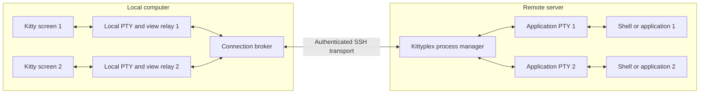
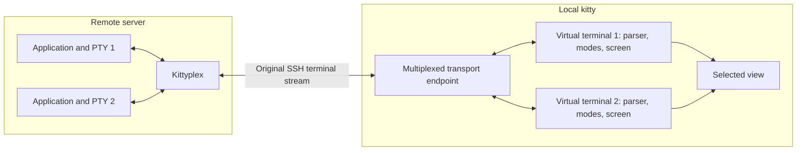

# Remote sessions with kitty-owned terminal state

Status: historical requirements and design analysis. Approach 1 with the original
terminal carrier was subsequently selected and implemented; approach 2 remains
unimplemented. Read [How kittyplex works](how-it-works.md) for the running system,
the [carrier reference](original-terminal-carrier.md) for its current contracts,
and [compatibility](kitty-compatibility.md) for validation evidence.

Analysis baseline: 2026-10-31, with local Kitty 0.49.1 source inspection. This
analysis compared the alternatives before the carrier implementation existed.
Its prototype descriptions, proposed stack-tab presentation, capability findings,
estimates and D-xx entries preserve that context rather than specifying today's
implementation. The R-xx requirements and acceptance scenarios retain their
identifiers. Linked upstream source files track `master` and may differ from the
inspected version. This document superseded the earlier suggestion that each
local Kitty window should start an independent remote login shell.

## 1. Goal and ownership model

The user opens kitty on their computer, logs into a server with SSH, starts
`kittyplex` there, creates additional sessions, and switches between them:

```sh
ssh server
kittyplex
# Create sessions and switch using Ctrl-Shift-M commands.
```

Remote kittyplex owns the application processes and their PTYs. Local kitty owns
the terminal emulation and keeps a separate, continuously maintained terminal
state for every session. A session switch changes which state is displayed;
it does not reconstruct a screen or restart a process.

| Responsibility | Owner |
| --- | --- |
| Create shells and other application processes | Remote kittyplex |
| Own PTY masters, controlling terminals, process groups, and child lifecycle | Remote kittyplex |
| Interpret application terminal output | Local kitty |
| Keep screen contents, parser state, cursor, scrollback, and terminal modes | Local kitty, separately per session |
| Encode keyboard and mouse events according to a session's terminal modes | Local kitty |
| Deliver input and terminal responses to the appropriate remote PTY | Kittyplex transport and routing layer |
| Present and manage the selected view | Kitty integration coordinated with kittyplex |

Kittyplex must not contain a terminal-emulation library or reproduce kitty's screen
model. Framing opaque byte streams and handling explicit management messages is
permitted and necessary.

The local computer still has terminal endpoints in approach 1. Those endpoints
belong to transport relays; the actual application processes and application PTYs
remain remote. Local and remote PTYs are distinct objects.

## 2. Reading this document

- **Required** means part of the agreed behavior and must hold for either approach.
- **Verified capability** means established through documentation or source
  inspection, not necessarily exercised in a complete running system.
- **Proposed design** means an implementation candidate, not an existing API or a
  final product decision.
- **Open decision** means implementation must not silently choose a policy.

Requirements use `R-` identifiers, acceptance scenarios use `A-` identifiers, and
open decisions use `D-` identifiers. Recommendations and provisional estimates
are separate from requirements.

## 3. Shared requirements

| ID | Requirement |
| --- | --- |
| R-01 | Support starting remote kittyplex after an SSH login and creating and switching sessions from there. Explicitly document any local installation, SSH configuration, or bootstrap prerequisites. |
| R-02 | Remote kittyplex must create and retain ownership of application processes and PTY masters. Creating a display must not create a substitute independent SSH login shell. |
| R-03 | Local kitty must maintain independent terminal state for each remote session, including independent parsing of partial escape sequences and UTF-8 output. |
| R-04 | Kittyplex must transport application output without interpreting it into a screen model. |
| R-05 | Switching between existing views must preserve their state without output replay, artificial resizing, or application-specific redraw commands. Real terminal resizing may require application redraws. |
| R-06 | Output from hidden sessions must continue updating their own terminal states, in order and without silent loss. Use bounded queues and backpressure rather than discarding output. |
| R-07 | Route keyboard input, paste, mouse reports, focus reports, and terminal-generated responses to the originating session's PTY. Do not route a delayed response to whichever session happens to be selected later. |
| R-08 | Preserve remote job control. Ctrl-C and Ctrl-Z must affect the remote foreground job appropriately rather than the local relay or remote controller. |
| R-09 | Propagate real terminal dimensions to each corresponding remote PTY and let its terminal driver notify the foreground process group. |
| R-10 | Use the configurable Ctrl-Shift-M management prefix. Preserve ordinary Ctrl-M/Enter and provide a way to send the reserved chord to an application. |
| R-11 | Associate messages and views with stable session and group identities. Keep navigation positions separate from identities; window titles are not identities. |
| R-12 | Independent kittyplex groups, including multiple SSH logins to the same server, must not send input to or close each other's sessions. |
| R-13 | Define startup failure, session exit, view closure, controller exit, and transport-loss behavior. Clean up owned resources without affecting unrelated windows or processes. |
| R-14 | Negotiate or verify compatible local and remote components. Unsupported configurations must produce an actionable error rather than silently claiming reliable restoration. |
| R-15 | Remote management must have a bounded, explicit local capability. Do not require unrestricted execution of remote-supplied local commands. |
| R-16 | A busy or unresponsive session must not starve management traffic or other sessions indefinitely. Establish latency and resource limits through measurement before release. |

### 3.1 Management behavior to retain

| Sequence | Behavior |
| --- | --- |
| Ctrl-Shift-M, `c` | Create and select a session |
| Ctrl-Shift-M, `n` / `p` | Select next / previous session, wrapping around |
| Ctrl-Shift-M, `1`–`9` | Select the session at that current position |
| Ctrl-Shift-M, `q` | Quit the kittyplex group |
| Ctrl-Shift-M, Escape | Cancel management mode silently |
| Ctrl-Shift-M, Ctrl-Shift-M | Send one literal reserved chord to the application |

Management mode ends after one action. Unknown keys cancel with a bell when
enabled, without being passed to the application. Activate mappings only for
kittyplex views. Keep equivalent command-line control available where practical;
the original prototype's `kittyplex ctl` interface is a compatibility reference,
not a selected remote wire protocol.

### 3.2 Scope and boundaries

The initial target remains Rust and Linux for the remote process manager, with
kitty as the local terminal. Local-platform support beyond the inspected Linux
environment needs a separate validation matrix; it is not established here.

The initial scope does not require panes, a terminal-independent UI, persistent
reattachment from a new kitty instance, or simultaneous clients attached to the
same session. A dedicated stack of kitty windows is an architectural candidate,
not an agreement to expose additional user-facing panes.

Separate terminal state does not imply that every effect is isolated. The desktop
clipboard and some OS-window settings are inherently shared. Host-aware features
and file-based graphics transports require specific compatibility testing.

Whether the workflow must work through **any already-running, unprepared plain
SSH login** remains open in D-01. Do not equate one SSH network connection with
one SSH channel, or one SSH channel with the original terminal byte stream.

## 4. Current prototype and evidence baseline

**Historical baseline:** this section describes the prototype inspected before
the carrier implementation. That prototype forwarded the selected session's
output, discarded inactive output, cleared the display on switch, and briefly
changed PTY dimensions to encourage a redraw. It had no independent per-session
terminal screen models and did not meet the clarified remote-display requirements.

The original kitty kitten connected to a Unix socket on the local machine. A socket
path exported by remote kittyplex would refer to the remote filesystem and cannot
be used directly by that local kitten without a transport or forwarding layer.

The following source-inspection findings supported the original analysis:

| Finding | Evidence and limitation |
| --- | --- |
| Kitty has a stack layout with one visible internal window | Documented in [S1]. Installed 0.49.1 source lays out all groups, including hidden groups. This was source inspection, not a full bridge test. |
| Kitty can launch relays and identify windows | Launch options include executable arguments and user variables; watchers expose lifecycle events [S2]. |
| Remote control can cross an SSH terminal | Documented, subject to kitty authorization and transport conditions [S3, S4]. This does not itself implement multiplexed terminal data. |
| Kittens can invoke commands and access internals | Supported extension mechanism, but internal APIs are not fully stable or documented [S5]. |
| Kitty associates native child monitoring with a screen | Observed in installed Python integration and upstream native source [S9]. |
| Native screens already include parser and terminal state | Established by source inspection [S10, S11, S12]. |
| Private parser test hooks exist | Observed in 0.49.1 and upstream source. Basic isolated-screen parsing was exercised; broader experiments encountered buffer-ownership constraints. No supported live injection API or end-to-end integration was established. |
| SSH supports forwarded Unix sockets and connection sharing | Documented in OpenSSH [S7, S8]. Server policy and client setup still apply. |

At that point no complete bridge, native multiplexer, live GUI integration,
throughput benchmark or reconnect implementation had been validated. Prototype
tests established individual local PTY behaviors only; some application tests
were skipped because the execution environment prohibited Unix socket binding.
Those skips were not positive evidence for either remote architecture. Later
implementation evidence is recorded in the compatibility reference linked above.

For future private-API or core work, pin an exact kitty revision. Upstream
`master` links below are explanatory references, not a reproducible compatibility
guarantee.

## 5. Approach 1: existing kitty windows with transport relays

### 5.1 Proposed components and data flow

The following preserves the original proposal, including its stack-tab candidate.
The implemented process and tab arrangement is explained in the guide linked at
the beginning of this document.

Use one existing kitty window per remote application PTY. Each local window runs
a view relay. A local broker connects those relays to remote kittyplex. Kitty keeps
the windows in a stack and preserves each window's screen normally.



The view relay reads input from its local terminal and writes remote output to
that terminal. It forwards opaque bytes in both directions and reports dimensions.
It must use appropriate raw terminal settings so input signals and output
translations are not applied a second time locally.

The broker manages local view associations and transport queues. Remote kittyplex
remains the authority for application creation, PTY ownership, and process
lifecycle. A local window is a display attachment, not the application owner.

Kitty's `send-text` operation sends input **toward a window's child**. It is not
an output-rendering interface. The normal output path is through the relay's PTY
into kitty's own parser [S3, S4].

### 5.2 Startup and session creation

Proposed ordering:

1. Remote kittyplex establishes a compatible, authorized connection with local
   integration and associates it with the originating SSH window.
2. Local integration prepares a group, preferably a dedicated stack tab, while
   retaining the originating window for returning to the SSH shell.
3. Kittyplex reserves a stable remote session identity.
4. The broker creates a view running a fixed local relay executable.
5. The relay reports readiness, dimensions, and terminal metadata.
6. Kittyplex starts the remote application with the agreed PTY settings and streams
   output to the ready view.

Alternatively, kittyplex may start the application earlier only if all initial
output is buffered without loss until the view is ready. Failed or cancelled view
creation must not leave an untracked application running.

A session switch selects an existing kitty window. Native kitty focus changes
must also update the session association. Use stable IDs and user variables,
rather than titles that applications can change.

### 5.3 Transport alternatives

These are alternatives within approach 1. Using the original SSH terminal as the
carrier does not make an implementation native approach 2 if separate local
relays still supply ordinary kitty windows.

| Transport | Mechanism | Setup conditions | Assessment |
| --- | --- | --- | --- |
| Forwarded broker socket | Remote kittyplex connects to a remote Unix socket forwarded to the local broker | Forwarding prepared at connection time, or added through a usable ControlMaster; server must permit it | Recommended first conventional prototype |
| Additional SSH execution channel | Local broker starts a non-PTY remote attachment helper that connects to existing kittyplex | Correct host/authentication configuration; a usable shared connection if no new login is permitted | Viable with explicit connection integration |
| Original terminal carrier | Kittyplex wraps session data in authorized kitty control messages; a local helper forwards it to relays | Local helper and kitty authorization; framing and return routing through the originating terminal | Closest to an unprepared existing login, but performance and correctness are unproven |

**Forwarded socket.** OpenSSH can forward a remote Unix socket to a local Unix
socket. One broker connection can multiplex all application sessions using
explicit session identities [S7]. This preserves binary data without terminal
encoding and avoids additional authentication. A narrow kittyplex broker endpoint
is preferable to forwarding unrestricted kitty control. Endpoint discovery,
connection scoping, permissions, and stale-forward cleanup need specification.

**Additional execution channel.** An attachment helper can run with no newly
allocated remote PTY and relay frames to the existing kittyplex manager. It must not
start replacement application shells. ControlMaster permits additional sessions
over one network connection, but OpenSSH can fall back to a new connection when
the master is unavailable [S8]. The integration must detect that situation if it
would violate the selected workflow.

Remote `$SSH_CONNECTION` does not encode client aliases, jump-host configuration,
identity selection, or the full local connection context. Do not assume that it
is enough to reconstruct the correct SSH invocation. Kitty's SSH kitten provides
useful integration [S6], but requiring it is a product decision, not an established
requirement. Do not automatically enable agent forwarding to solve discovery.

**Original terminal carrier.** Kitty's remote-control protocol can invoke a custom
kitten through terminal messages [S3, S4]. A helper could deliver encoded data to
the broker, while input returns as framed messages through the controller's
terminal. All application bytes must be encoded as payload, not interpreted in
the controller window. The carrier PTY needs settings that preserve those frames.

Base64 adds roughly one-third to payload size, before framing overhead. In the
inspected implementation, custom kitten invocation loads Python code and runs
the no-UI handler synchronously in kitty. Per-chunk invocation therefore raises
UI scheduling and throughput concerns. Neither a round trip per output chunk nor
unbounded synchronous work in kitty is an acceptable assumed design. Benchmark
this carrier before choosing it for bulk application output.

### 5.4 Input, responses, resizing, and fairness

Relay input includes both user-generated bytes and terminal-generated responses.
It must always return to the relay's associated remote PTY, even if another
session becomes selected before delivery. Management commands travel separately
from application input.

Kitty encodes keys using the view's terminal state. The relay must not enable its
own conflicting keyboard mode or reinterpret application input. Remote terminal
settings determine how Ctrl-C and Ctrl-Z affect foreground jobs.

Actual size changes follow this path:

```text
kitty view geometry -> local PTY resize -> relay size notification
    -> remote kittyplex -> TIOCSWINSZ on application PTY
```

Watchers can supplement resize, focus, and closure handling [S2]. They are not
stream-processing callbacks. Validate hidden views' sizes and query responses in
a real kitty instance, not only with mocked watcher tests.

Queue each session independently, preserve ordering, and limit queued bytes.
Apply backpressure when a destination cannot consume data. Fair scheduling must
keep input and management responsive during background floods. A shared SSH/TCP
connection still has shared bandwidth and transport-level head-of-line effects.

### 5.5 Authorization and compatibility

The local broker should expose only group-scoped operations. Remote requests
must not supply arbitrary local executable paths or shell commands. The local
helper selects the installed relay executable and validates group/session
associations. Kitty's custom remote-control authorization can inspect command
arguments when action-name permissions are insufficient [S3].

Normal character output, escape sequences, and mode negotiation should use
kitty's existing PTY/parser path. Additional validation is needed for:

- Correct `TERM`, terminfo availability, and per-view terminal identity metadata.
- Host-aware working-directory operations and shell integration: kitty sees a
  relay as its local child rather than the original SSH client.
- Features that use local file paths, shared memory, or SSH-kitten assumptions.
- Application title changes, clipboard operations, graphics, and nested SSH.

Do not claim that opaque byte forwarding automatically preserves every
host-aware kitty feature. Correctly framed inline protocol data and filesystem
access are different compatibility questions.

### 5.6 Complexity and provisional recommendation

This approach reuses normal kitty windows and the documented launch/control
surface. It avoids maintaining a modified kitty binary, at the cost of a broker,
relay processes, and connection integration.

Recommendation: test a forwarded kittyplex socket first to establish correct data
flow and screen preservation. Investigate the original-terminal carrier
separately if D-01 requires operation through unprepared existing SSH logins.
Do not treat success with a preconfigured forward as proof of that stronger
requirement.

## 6. Approach 2: native virtual terminals over the original SSH stream

### 6.1 Proposed architecture

Remote kittyplex multiplexes session traffic through its existing SSH terminal.
Kitty recognizes the transport, routes payloads into independent native terminal
instances, and returns input and responses with the corresponding session ID.



There are no per-session local application shells. Existing kitty parsing and
rendering should be reused. The change is to separate a terminal instance from
the assumption that it is attached to one local child process and PTY.

Independent parser state is essential. Session A can pause in an incomplete
escape sequence while B produces output. The transport parser must route opaque
payload before the appropriate session's terminal parser interprets it.

### 6.2 Extension-only feasibility

| Integration level | What it provides | Limitation |
| --- | --- | --- |
| Supported kittens and watchers | Management commands, window creation, lifecycle coordination | No documented complete replacement terminal-transport interface |
| Remote control | Framed commands and invocation of helpers | Not a native per-session terminal input/output backend |
| Private Python/native objects | Access to screens and internal machinery; possible experiments | Unstable interfaces, native object registrations, buffer ownership, and reply routing |
| Focused core transport API plus kitten | Native-safe terminal endpoints with Python orchestration | Requires kitty changes; patch size remains unproven |
| Full native protocol | First-class multiplexing integrated into kitty | Largest implementation and ongoing maintenance commitment |

A regular kitten cannot be assumed to intercept the SSH byte stream before
normal terminal parsing or safely feed arbitrary data into independent live
screens. Watchers report events, not arbitrary child-output bytes [S2, S5].

Private APIs may support a demonstration without modifying the binary. That is
not equivalent to a supported extension. Native child monitoring and rendering
also retain screen associations, so assigning `window.screen` alone is not a
complete routing change. Native response-writing paths must be considered as
well as Python keyboard handlers [S9, S10].

### 6.3 Preferred native investigation: focused hooks plus orchestration

Proposed division:

| Native kitty responsibilities | Python kitten responsibilities |
| --- | --- |
| Create terminal instances backed by a transport rather than an application child | Map remote groups and sessions to local views |
| Enqueue output safely into each native parser | Handle session-management requests |
| Route every outgoing terminal byte through its endpoint | Implement shortcut behavior and selection coordination |
| Keep parser, renderer, input, and resource registrations consistent | Present status and errors |
| Coordinate native queue ownership, cleanup, and disconnection | Restore the original view on group exit |

Conceptual capabilities, **not existing APIs or selected signatures**:

```text
create_virtual_terminal(metadata)
feed_terminal_output(session_id, opaque_bytes)
on_terminal_input(session_id, opaque_bytes)
on_terminal_resize(session_id, dimensions)
destroy_virtual_terminal(session_id)
```

Creating ordinary internal windows backed by virtual transport endpoints may
require fewer rendering changes than switching multiple screen objects under
one window. This is a hypothesis to test. It must not quietly reintroduce local
application ownership or require fake child process IDs.

Do not assume that a focused API will be a small patch. First identify every
relevant child/PTY assumption and native outbound path, including response
generation, paste, focus, sizing, and closure.

### 6.4 Native implementation areas

- **Transport framing:** support discovery, version compatibility, message
  boundaries, opaque payloads, session identities, and explicit limits. Application
  bytes resembling the transport must remain data. Do not invent the final wire
  format before the feasibility experiments.
- **Parser integration:** route complete payloads to session-specific parsers
  while preserving partial terminal-sequence state across transport frames.
- **Input and response routing:** tag keyboard, mouse, paste, focus, terminal
  queries, and other native output before writing through the shared SSH stream.
- **Resource ownership:** distinguish transport lifetime, virtual-terminal
  lifetime, and application lifetime. Destroying one view must not terminate the
  shared SSH child or other sessions.
- **Rendering and state:** retain cursor, main/alternate buffers, keyboard modes,
  scrollback, selections, graphics, and real resize behavior per terminal instance.
- **Scheduling:** bounded per-session queues, responsive management, and safe
  interaction with kitty's I/O and main loops.
- **Deployment:** capability negotiation, supported kitty versions, packaging,
  and an upstream-versus-maintained-patch strategy.

Kitty already has native screen and parser machinery [S10, S11, S12]. This
approach should extend transport and ownership abstractions rather than implement
a second terminal emulator in kittyplex.

### 6.5 Complexity and estimates

Relative assessment: supported relay integration is medium complexity; private
internal integration has high maintenance risk; focused native hooks plus a
kitten are medium-to-high initial complexity; a complete native protocol is a
high-complexity maintained feature.

For one engineer already familiar with kitty, a restricted demonstration might
take days to a few weeks. Reliable support for ordinary interactive programs,
multiple keyboard modes, background output, resizing, and failure cleanup could
take several weeks to a few months. These are provisional engineering estimates,
not measured schedules or commitments. They exclude persistent reattachment,
comprehensive platform support, and upstream review time.

Recommendation: investigate focused hooks before committing to a full core
implementation. The first milestone is two independent virtual terminals with
correct bidirectional routing through one original SSH stream, not a polished
session-management UI.

## 7. Cross-cutting lifecycle and failure requirements

| Event | Required invariant / decision |
| --- | --- |
| Session switch | Preserve existing process and terminal state; no synthetic resize or dropped bytes. |
| Initial view creation fails | Report failure and cancel or clean up reserved resources; do not lose startup output or leave an untracked process. |
| Application exits | Reap it, preserve ordered final output according to the selected close policy, and synchronize remote and local state. |
| User closes a view using kitty controls | Notify the manager; apply D-03 without affecting other groups. |
| Output cannot be delivered promptly | Bound memory and apply backpressure; do not silently drop terminal bytes. |
| Controller quits explicitly | Close the group and restore the original terminal/view according to the documented lifecycle policy. |
| Original SSH controller exits or transport is lost | Apply D-02; neither side may silently claim that all terminal state can be recovered. |
| A local view is destroyed | Its screen state is lost unless a separate recovery mechanism exists; recreating an empty view is not restoration. |
| A delayed response arrives | Route by its originating session identity, not current selection or a reused position. |
| Group or session identity is stale | Reject it; never apply it to a newly created unrelated session. |

Process survival and display survival are separate concerns. A transient outage
could be recoverable while the same kitty screens remain alive if all missing
bytes are retained and correctly delivered. That requires sequencing and recovery
logic; it is not a consequence of keeping processes alive.

Starting a new kitty instance after the original screens were destroyed is a
different requirement. Neither approach here establishes reliable fresh-client
reattachment without additional state reconstruction or preservation.

## 8. Architecture comparison

| Dimension | Approach 1: existing windows and relays | Approach 2: native virtual terminals |
| --- | --- | --- |
| Remote process/PTY ownership | Kittyplex | Kittyplex |
| Terminal emulation | Existing kitty windows | Native kitty terminal instances |
| Kitty binary changes | Not required for the conventional relay design | Probably required for a supported implementation; private-API prototypes are uncertain |
| Local components | Kitten/integration, broker, per-view relays | Modified kitty support, likely a management kitten |
| SSH transport | Forwarded socket, extra execution channel, or encoded terminal carrier | Original terminal stream with native multiplexing |
| Unprepared existing SSH login | Conditional; original-terminal carrier requires investigation | Intended capability after local support/authorization is installed |
| Bulk-data path | Ordinary streaming for socket/channel variants; control-message carrier has extra overhead | Can be integrated with native queues; performance remains unmeasured |
| Existing kitty rendering reuse | High | High if transport endpoints reuse terminal instances |
| Main implementation risk | Bootstrap, connection discovery, framing, and lifecycle | Native ownership assumptions, routing, threading, and compatibility |
| Ongoing maintenance | Multiple components; primarily documented kitty interfaces | Kitty-version coupling, patch maintenance, and possible upstream work |
| Fresh-client persistent reattachment | Not established | Not established |

At the time of this comparison neither architecture had been selected. Its
recommendations were research priorities, not permission to relax the shared
requirements.

## 9. Relationship to the existing implementation

This is the original migration assessment against the pre-carrier prototype,
not a list of remaining changes. File links identify related subsystems, whose
contents have since changed; the guide provides the current source map.

| Subsystem | Reuse candidate | Proposed change from the original baseline |
| --- | --- | --- |
| PTY/process backend in [src/session.rs](../src/session.rs) | PTY allocation, controlling-terminal setup, child spawning, process groups, resize, and reaping | Retain remote ownership; connect every output stream to a lossless session transport rather than a visibility-dependent sink. Review cleanup semantics against D-02/D-03. |
| Event loop and switching in [src/main.rs](../src/main.rs) | Polling and bounded-I/O concepts | Replace shared-terminal rendering, inactive-output discard, and artificial redraw. Decouple process state from view selection. |
| Control plane in [src/control.rs](../src/control.rs) | Command concepts and private local IPC | Add a scoped local/remote relationship; current socket paths do not cross SSH automatically. The present text protocol is not the selected transport format. |
| Kitty helper and mappings | Prefix behavior, conditional activation, and literal-chord forwarding | Bind local views to remote group/session identities; avoid blocking kitty while waiting for network work. |
| Terminal guard | Saved terminal-settings and cleanup patterns | Apply settings to each transport/relay endpoint as appropriate; do not reset one shared screen's modes as a substitute for independent terminal state. |
| Tests | Existing PTY, job-control, and mapping checks | Add real kitty/SSH integration and the acceptance scenarios below. Mock routing and skipped tests do not establish end-to-end behavior. |

The migration proposal called for retaining public CLI behavior where practical
and explicitly designing bootstrap, attachment and protocol interfaces. Its
conceptual interfaces are not API specifications; use the carrier reference for
the implemented contracts.

## 10. Acceptance scenarios

Run applicable scenarios against a pinned local kitty build and a real remote
Linux SSH environment. Record versions, transport variant, server configuration,
and any skips. A scenario involving a view must verify both the screen and the
remote process association.

| ID | Scenario and expected result | Requirements |
| --- | --- | --- |
| A-01 | Log in, run remote kittyplex, create several sessions, and switch. Remote PIDs and PTYs remain unchanged; no replacement login shell is created by view selection. | R-01, R-02, R-05 |
| A-02 | Produce shell output, edit a partial command line, switch away, then return. Screen contents, cursor, and editing state remain correct without redraw commands. | R-03, R-05 |
| A-03 | Run Vim and less in different sessions. Exercise main/alternate buffers and switch repeatedly. Each view preserves its own contents and modes. | R-03, R-05 |
| A-04 | Interleave output with one session paused in partial escape and UTF-8 sequences. Each parser completes its own stream with no cross-session interpretation. | R-03, R-04, R-06 |
| A-05 | Issue terminal queries from a hidden session while switching another session. Replies return exactly to the querying PTY with no duplicates or cross-routing. | R-06, R-07, R-11 |
| A-06 | Use different keyboard/mouse modes in two sessions. Test paste, focus, key releases, the management prefix, its literal escape, and ordinary Enter. Input follows each session's modes. | R-07, R-10 |
| A-07 | Interrupt and suspend remote foreground jobs, inspect jobs, and resume them. The relay/controller survives and remote job control remains correct. | R-02, R-08 |
| A-08 | Resize with foreground and hidden sessions, including during output. Remote dimensions match their views; ordinary switching does not manufacture resizes. | R-05, R-09 |
| A-09 | Flood hidden sessions while typing in another and issuing management commands. Measure latency, CPU, memory, and throughput; observe bounded queues with no silent loss. | R-06, R-16 |
| A-10 | Run two groups against the same server and inject stale or wrong-group references. Neither can route input to or close the other's resources. | R-11, R-12, R-15 |
| A-11 | Fail view startup, exit an application, close a kitty view, and quit the group. Verify the selected lifecycle policy, cleanup, ordered output handling, and return to the original shell/view. | R-05, R-13 |
| A-12 | Interrupt transport and destroy/recreate a local view. Apply the chosen failure policy and report recovery limitations; never present a blank new view as restored state. | R-06, R-13, R-14 |
| A-13 | Run with missing integration, incompatible components, disabled forwarding, and denied local management. Fail clearly without unexpected authentication or unrestricted local command execution. | R-01, R-14, R-15 |

Passing the basic text scenarios is not sufficient evidence for graphics,
host-aware shell integration, nested SSH, or other untested kitty features.

## 11. Feasibility experiments and selection gates

| Experiment | Evidence to collect | Gate |
| --- | --- | --- |
| E-01: bridge baseline | Two remote application PTYs attached to two real stacked kitty windows through a controlled forwarded socket | Demonstrate R-02 through R-09 without a kittyplex emulator. |
| E-02: exact workflow bootstrap | Attempt the selected connection setup, including two logins to the same host and relevant aliases/jump hosts | Resolve D-01 and identify explicit prerequisites; do not rely on automatic host guessing. |
| E-03: original-terminal bridge carrier | Measure encoded/control-message throughput, input latency, kitty responsiveness, and queue behavior | Determine whether approach 1 can satisfy a no-prepared-side-channel requirement. |
| E-04: virtual-terminal hooks | Register two native terminal instances without local application processes; route output, queries, input, resize, and closure | Determine which core changes approach 2 actually requires. |
| E-05: shared-stream native transport | Interleave session frames, split terminal sequences, and fail the shared connection | Validate independent parser state and safe shared-transport lifecycle. |
| E-06: compatibility and performance | Run the acceptance matrix and compare against direct SSH and the bridge baseline | Establish supported features and measurable release limits. |

Measurements should include input-to-visible-response latency under idle and
flooding conditions, sustained output throughput, local and remote CPU usage,
per-session memory, queue high-water marks, and behavior at representative network
latencies. No performance advantage is established by this analysis alone.

Do not implement both complete architectures in parallel before these gates.
The remote PTY/process backend and opaque transport concepts should remain
separable from the local display backend so experiments can share useful work.

## 12. Open decisions before implementation

These were the questions recorded before architecture selection. They are
preserved for rationale and future alternatives, not presented as unresolved
instructions for the current implementation.

| ID | Decision | Why it matters / current recommendation |
| --- | --- | --- |
| D-01 | Must any existing plain SSH login work without prepared forwarding or ControlMaster? | Determines whether a conventional bridge meets the workflow. Treat preparation-free operation as unproven, not optional by assumption. |
| D-02 | What happens on original-controller exit or transport loss? | Initial scope has no detach/reattach promise. Recommended initial policy is group shutdown on controller termination or unrecoverable loss, with explicit cleanup and reporting. Confirm before coding recovery behavior. |
| D-03 | Does manually closing a view terminate its remote session or only remove its display? | Removing a display loses terminal state. Recommended initial policy is an explicit session-close operation with appropriate remote cleanup, rather than silent detached persistence. |
| D-04 | Which approach and transport variant should be implemented first? | Recommend the conventional bridge as a baseline, then original-stream experiments where D-01 requires them. No architecture selected. |
| D-05 | What local installation and SSH-kitten/configuration prerequisites are acceptable? | Needed for honest startup behavior, authorization, and endpoint discovery. Do not assume a remote binary alone can configure the local computer. |
| D-06 | For native integration, private APIs, a maintained core patch, or upstream-supported hooks? | Recommend investigating focused core hooks plus kitten orchestration; maintenance obligations differ substantially. |
| D-07 | Which kitty features/platforms are release requirements, and what latency/resource targets apply? | Needed to turn E-06 into release acceptance rather than a qualitative demonstration. |

Only R-01 through R-16 and the retained management behavior are normative here.
Proposed transports, interfaces, lifecycle defaults, estimates, and research
priorities must not be mistaken for resolved implementation decisions.

## 13. Sources

References were consulted during the architecture investigation. Documentation
and upstream source can change; preserve a revision/version record when using
them to implement or validate the design.

- **S1:** [Kitty layouts and stack layout](https://sw.kovidgoyal.net/kitty/layouts/#the-stack-layout).
- **S2:** [Kitty launch interface and window watchers](https://sw.kovidgoyal.net/kitty/launch/).
- **S3:** [Kitty remote control and authorization](https://sw.kovidgoyal.net/kitty/remote-control/).
- **S4:** [Kitty remote-control wire protocol](https://sw.kovidgoyal.net/kitty/rc_protocol/).
- **S5:** [Custom kittens and internal API stability](https://sw.kovidgoyal.net/kitty/kittens/custom/).
- **S6:** [Kitty SSH integration](https://sw.kovidgoyal.net/kitty/kittens/ssh/).
- **S7:** [OpenSSH client manual: PTYs, execution channels, and forwarding](https://man.openbsd.org/ssh.1).
- **S8:** [OpenSSH client configuration: connection sharing and socket forwarding](https://man.openbsd.org/ssh_config.5).
- **S9:** [Kitty native child monitor, upstream master](https://github.com/kovidgoyal/kitty/blob/master/kitty/child-monitor.c).
- **S10:** [Kitty native screen implementation, upstream master](https://github.com/kovidgoyal/kitty/blob/master/kitty/screen.c).
- **S11:** [Kitty native terminal parser, upstream master](https://github.com/kovidgoyal/kitty/blob/master/kitty/vt-parser.c).
- **S12:** [Kitty native screen state, upstream master](https://github.com/kovidgoyal/kitty/blob/master/kitty/screen.h).


## Implementation compatibility follow-up (kittyplex 0.3)

The current geometry/protocol contract is maintained in the
[carrier reference](original-terminal-carrier.md#protocol-v2-kittyplex-03);
feature evidence is maintained in [compatibility](kitty-compatibility.md).

### Native tab presentation follow-up

For the implemented presentation, see the
[guide](how-it-works.md#1-what-the-tabs-represent) and the
[selection/lifecycle rules](usage.md#controls-and-lifecycle). These supersede
the stack-tab candidate preserved in the original approach-1 proposal.
