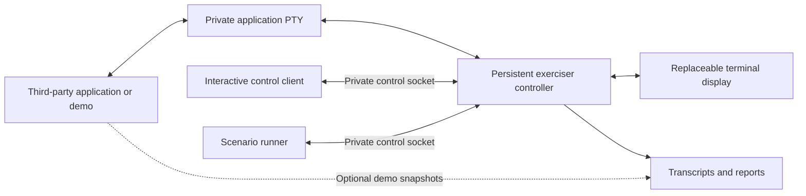

# Restore Display demos and protocol exerciser specification

Status: **implementation requirements; not implemented**. Updated 2026-11-02.
This is the primary input for the staged demo suite. The
[Restore Display specification](terminal-recovery-protocol-spec.md) defines the
wire contract; this document defines functionality, integration examples and
acceptance evidence. The [research document](terminal-recovery-protocol.md)
provides rationale. Existing filenames are retained for link stability.

## 1. Goals and structure

Build reference applications that maintainers can copy and adapt, plus a
standalone exerciser usable with their own applications. The same process must
retain its application state, restore a genuinely fresh terminal, and handle the
next input/output correctly. No production Kittyplex detach implementation is
included in these requirements.

Every variant separates a small protocol codec, a framework adapter and an
application model. The codec implements ASCII fields and transaction matching;
the adapter receives events below keymaps and safely initializes/redraws; the
model owns content, pending input and graphics. Conceptual hooks are enable,
display_detached, restore_display, disable and re-enable after child return.
The adapter writes begin/complete markers around the restore callback. Completion
means its ordered output has been written to the PTY, not a render merely scheduled.

Protocol support must be opt-in, and ordinary operation without a supporting
controller must remain usable. Invoking an experimental demo attempts versioned
v0 enablement by default; --protocol=off emits no protocol frames. A demo advertises the single
Restore Display promise, not a framework name or per-feature coverage list.
Features enabled in the interface must all be restored or the request refused.

## 2. Common framework responsibilities

The input decoder must recognize protocol events during dialogs, editing, search
and terminal-query waits. A static application blocked waiting for input must
still service restoration. Use a safe UI execution point and a serialized drawing
path, never arbitrary concurrent curses calls or asynchronous signal-handler
rendering. Background activity changes the model, not terminal output directly.

A restore request establishes attached display status without a separate attached
notification. At a safe execution point, finish or stop older rendering, write
pending earlier output to the PTY, emit the matching start marker, reestablish
modes/resources, draw the interface, and write completion after that output.
Refusal uses the unavailable action. No protocol input is a
redraw keybinding. On child handoff, consume disable acknowledgement before giving
input away; on return send the versioned enable request again. Resource IDs and
stored parent baselines must be application-owned and reconstructable.

Intentional detach and unexpected loss use the same detached notification without
preparation or readiness. Pause drawing and display queries when practical while
preserving application data. The adapter may finish its running callback before
servicing a newer restore, retains only the newest decoded pending request, and
never runs restore callbacks concurrently. Loss clears earlier pending requests;
stale completions cannot release controller input gates.

Follow the [PTY integration contract](terminal-recovery-protocol-spec.md#9-pty-integration):
configure compatible input before enable, consume disable acknowledgement before
terminal cleanup or foreground handoff, and serialize resize handling with redraw.
Read current dimensions in the restore callback. Controller traces must show input
and obsolete-output gates before TIOCSWINSZ and the restore request. Keep terminal
replies operational during restoration and consume PTY output while detached.
Normal restoration never calls tcflush or uses TCSAFLUSH to discard pending data.

The controller does not maintain an emulator or replay the old interface to make
the demo pass. The application may reuse its framework's existing model/cells.
Application state, protocol status and terminal display state remain distinct.

## 3. Common demo functionality

### 3.1. State and interface

Full-screen variants MUST expose the following common model and interface:

- A scrollable list of 100 numbered items with persistent selection and viewport.
- An unsaved editable UTF-8 text field with cursor and selection; editing changes
  model state without submitting it during restoration.
- Two panels, a status line, borders, basic colors and a modal dialog with its own
  editable value. A restoration may happen with either editor or dialog focused.
- A simulated background task with an incrementing counter, adjustable update
  rate, and pause/resume. It operates in memory and performs no destructive work.
- A static mode with all automatic updates paused, waiting for input. Restoration
  MUST work without an ordinary redraw tick or a manufactured keystroke.
- A graphics pane holding an application-generated image and its placement.
- A viewport/layout that adapts to terminal dimensions, plus a visible too-small
  state that preserves the model and remains protocol-responsive.
- A child-launch action supporting an explicitly supplied cooperating demo and
  an explicitly supplied unsupported child, with acknowledged disable
  before handoff and new negotiation on return.

Use one documented action vocabulary across variants: move selection, edit text,
open/close dialog, toggle counter, change image, toggle static mode and launch
child. Standard navigation is arrows, Tab to cycle focus, Enter to commit a local
edit/action, Escape to close a dialog, and Ctrl-Q to quit outside an active text
edit. Exact keymaps MAY follow library conventions, but MUST be documented and
MUST NOT be used as the restoration transport. The control UI is separate from the
application's keyboard input, so detach/restore actions cannot collide with these
bindings.

Deterministic startup defaults: item 0 selected, viewport 0, empty editable
values, no modal, counter 0, background updates paused, and image state A. The
reference layout at 80x24 places the list on the left, edit/graphics pane on the
right and a status row at the bottom. It must also support 120x40 and a too-small
40x10 viewport. Variant screenshots need not have identical font metrics or
border glyphs; logical content, placement constraints and interaction must agree.

A seed option controls generated graphics and any synthetic data. Restoration MUST
NOT increment a task counter, reset selection, submit an edit or change the image
state merely to make output different. Diagnostic restoration counts are separate
from application state.

### 3.2. Graphics as an initial requirement

The direct Rust reference MUST implement Kitty graphics in milestone 1. Use a
procedurally generated 64x64 RGBA image with a checkerboard and distinct colored
corners; image B changes the corner colors. The demo retains pixels or the seed
and logical image state, not a dependency on the old terminal's image store.
Use direct in-band image transfer; remote file paths/shared memory are excluded
from the initial graphics profile.

Generate pixels row-major as RGBA bytes. For coordinates x/y in 0..63, fill an
8x8 checkerboard with RGB (32,32,32) when `(x//8 + y//8 + seed) % 2 == 0`,
otherwise (224,224,224); alpha is always 255. Override the four 8x8 corner blocks
with red, green, blue and yellow, respectively, in top-left, top-right,
bottom-left, bottom-right order. A uses that order; B reverses it. Seed is an
integer in 0..4294967295. Use image ID 1 and placement ID 1 in an isolated demo
view; later images use ascending IDs. Integrations sharing a view must allocate
their own IDs. This formula gives every implementation the same expected data.

Support transmit/place, move, resize, replace and delete with explicit image and
placement IDs scoped to the demo. Cleanup MUST affect only resources owned by
that interface. Verify a dialog can cover the image without stale graphics
showing through, then reveal it again. Layout may use deletion/replacement rather
than depend on unsupported clipping behavior. Resizing recomputes placement from
new geometry. No image IDs from an old display may be assumed to exist in a fresh
one; retransmit current image data before reconstructing placements.

The decisive scenario destroys the original Kitty view, changes logical image A
to B while detached through the demo's controlled model progression, and attaches
a genuinely fresh display. It MUST show B and the current text without replaying
A's old graphics stream. The detached image change is prearranged before detach
(for example, a scheduled model change), not injected as input to an absent view.

If graphics support is unknown, resolve it through normal terminal probing only
while attached. If unavailable, show a text placeholder and report the graphics
case as unsupported. A full graphics-required run MUST fail/skip explicitly;
it MUST NOT pass on the placeholder. No blanket claim that tmux cannot display
graphics is permitted: comparisons must name tested versions, configuration and
specific behavior.

### 3.3. Advanced-feature profiles

All full-screen variants MUST document this matrix. The reference implements all
rows by stage 2; other variants implement the applicable rows according to
section 4. The first milestone may mark not-yet-implemented rows explicitly.

| Profile | Demo behavior | Restoration evidence |
| --- | --- | --- |
| `text` | Common panels, editing, dialog and Unicode including wide/combining text | Correct content, cursor and next edit at unchanged/changed geometry |
| `graphics` | Current image data, placements, replacement and layering | Fresh image resources and placement; no historical replay or stale image |
| `keyboard` | Kitty keyboard mode with distinguishable modified keys and event types | Correct event decoding after restoration and parent/child mode restoration |
| `text_sizing` | Large heading and fractional-size annotation with explicit cell width | Correct covered cells and following cursor/layout behavior |
| `colors` | Application default colors/palette changes with saved baseline | Current colors restored; exiting/handoff returns to the correct parent baseline |
| `pointer` | Text/pointer/resize shapes over interactive regions | Correct pointer after restoration and restoration on return |
| `terminal_modes` | Alternate screen, cursor style/visibility, mouse, paste and saved modes | Modes used by the interface reestablished; later restore/pop remains correct |
| `shell_metadata` | Prompt/current-directory and command-region markers in the prompt variant | Live prompt remains recognized; earlier output/history is not invented |
| `effects` | One explicit clipboard write and desktop notification per user action | Restoration does not duplicate operations; replies retain correct ownership |

These are exerciser profile names. `effects` is a negative replay test, not a
wire capability. These names describe demo/exerciser tests only; the protocol
advertises one promise, complete restoration of the interface actually in use.
Declared demo feature support MUST reflect the active interface, including raw
extensions outside a framework. If a saved parent stack/baseline cannot be reconstructed,
the participant MUST refuse that restoration rather than only restore the top value.
A test MAY choose a simpler known parent baseline, but must state that limitation.

Clipboard/notification tests use an isolated display and test-owned clipboard
state; they require explicit test opt-in on a real desktop. They MUST NOT silently
modify the developer's clipboard or issue desktop notifications as part of a
normal smoke run. There is no requirement to restore terminal configuration owned
by the user, such as global fonts or shaders.

### 3.4. Diagnostics and failure controls

Show display status, participation, transaction number and operation progress in the
application status area. Keep detailed logs out of terminal presentation. Each variant
supports `--seed INTEGER` (default 1), `--protocol=auto|off` (default auto),
`--log-file PATH`, and `--features COMMA_LIST` (default its implemented profiles).
Unknown requested features are a startup error. `--help` documents feature support,
requirements and limitations without requiring a terminal.

For demos only, support `--restore-behavior normal|delay|refuse|stall` and
`--restore-delay-ms INTEGER` (default 250, range 0..60000). Normal performs actual
restoration; delay waits before starting restoration;
refuse sends restoration unavailable; stall sends no terminal transaction response.
These controls MUST NOT change production protocol meanings or require special
messages from the controller. Emit restoration output in multiple chunks so the
exerciser can disconnect after a chosen byte offset. The renderer need not abort
mid-callback: test completion of the old callback followed by the newest pending
request, as well as cooperative early cancellation where implemented.

Optional demo-state instrumentation uses an inherited writable descriptor named
by `RESTORE_DISPLAY_DEMO_STATE_FD`. If absent, demos behave normally. If present, emit
UTF-8 JSON Lines snapshots with schema version 0, PID, model revision, selection,
viewport, edit values/cursor, modal/focus, counter, image state, and separate
protocol status. No terminal bytes or control commands travel on this descriptor.
Instrumented snapshots facilitate semantic assertions and MUST NOT be required
for exercising third-party applications. A model revision changes only for model
changes, not redraws.

The snapshot shape is:

```json
{"schema":0,"pid":1234,"model":{"revision":0,"selected":0,"viewport":0,"text":"","cursor":0,"selection":null,"dialog":null,"focus":"list","counter":0,"image":"A"},"protocol":{"enabled":true,"display":"detached","operation":null,"transaction":0,"restorations":0}}
```

Text cursor/selection indices count Unicode scalar values; selection is null or
an object with start/end integers. Dialog is null or an object containing text,
cursor and selection with the same rules. Focus is list, edit or dialog.
Protocol diagnostics use `display=initial|attached|detached`, independently of
`enabled` participation and `operation` (`null` or `restore`). These are observer
fields, not additional wire values. Initial is the starting condition
before status is first established, never a destination after disable, shutdown or
failure. While disabled, display retains its last-known value without claiming it
is current; a new enable response establishes the current value. Transaction is
0 before any transaction and otherwise the latest transaction number; operation
is null when no operation is pending. A failed restore keeps display attached
while available, and its failure/input gate is reported separately in the trace.
The restorations counter counts successful display restorations. The Readline
variant maps its live input to text/cursor and its active prompt/search/completion
interaction to focus edit. It reports its
auxiliary selection/task data in the same model fields. Detailed search-state
assertions require additional explicitly documented observer fields; unknown
snapshot fields are ignored. model_equal compares the model object, excluding
documented observer-only additions, and never compares protocol diagnostics.

## 4. Variants and implementation stages

| Variant | Framework and purpose | Required features |
| --- | --- | --- |
| `rust-direct` | Rust with direct terminal handling; compact reference implementation | Common interface and all advanced profiles |
| `rust-termina` | Rust with Termina and a small retained/diff renderer; preparation for Helix | Common interface, graphics, keyboard and terminal modes |
| `c-ncurses` | C/ncurses; shared adapter experiment and MC backend | Common interface, application-managed graphics, colors and terminal modes |
| `c-slang` | C/S-Lang; MC's other backend | Same requirements as c-ncurses |
| `c-readline` | C/GNU Readline; preparation for Bash | Prompt editing, search, completion, terminal modes, shell metadata and child handoff |
| `go-tcell` | Go/tcell; cell-based restoration | Common interface, graphics, keyboard and terminal modes |
| `go-bubbletea` | Go/Bubble Tea; typed event and model-driven renderer | Common interface, graphics, keyboard and terminal modes |

Executable names are `restore-display-demo-` followed by the variant ID. Keep
framework-specific code separate from the protocol codec and publish tested
library versions and any required patch. Optional profiles may initially be
unsupported; required profiles are not passed by silently showing placeholders.

The Readline variant uses a prompt-oriented equivalent rather than panels.
Commands select items and control the task/image; the pending input is the text
model. Exercise Emacs/Vi modes, incremental search, completion and child handoff.
Optional graphics appear above the prompt. This establishes Readline integration,
not complete Bash shell parsing, PS2 behavior or job-control support.

Each integration guide must identify initialization, input parsing, restoration,
completion and shutdown call sites, explain output barriers and owned graphics,
and show a minimal patch/annotated example. Include a literal protocol trace and
commands to run the exerciser against another application. Do not use keymap
bindings as a substitute for lower-level event integration.

| Stage | Acceptance gate |
| --- | --- |
| 1 | Codec/vectors, standalone exerciser and rust-direct reference with graphics; fresh text/image restoration and subsequent interaction pass |
| 2 | Termina, ncurses and Readline demos; full advanced reference; context, static-input, handoff and failure tests |
| 3 | S-Lang, tcell and Bubble Tea; shared scenarios across all seven, with explicit optional unsupported profiles |
| 4 | Experimental Helix, MC ncurses/S-Lang and Bash integrations; real application nesting and special states |

Real-application experiments may overlap later demos; upstream adoption is not a
prerequisite for the early stages. Eventually test Bash -> MC -> Helix -> MC ->
Bash and an unsupported child. No demo result establishes arbitrary unmodified
application ownership safety.

## 5. Protocol exerciser

### Architecture

The proposed executable is `restore-display-exerciser`. It launches any
caller-selected application directly under a private PTY, without an implicit
shell. A persistent controller owns that PTY while display clients come and go.
The exerciser is independent of Kittyplex and SSH. It must work without demo-only
instrumentation or application-specific control sockets.



The control client is separate from application input; no reserved application
key chord is needed. Controller logs/protocol captures must not be printed into
the interface. Capture raw input/output with offsets, timestamps, action/transaction
fields and injected faults. JSON is appropriate for reports, scenario files and
optional diagnostics; it is not used in the terminal protocol.

The session directory is caller-owned mode 0700 and its socket 0600. Refuse an
existing active directory rather than replace its application. Artifacts remain
private and are never uploaded automatically. Default raw capture budget is
64 MiB per direction; report truncation and fail assertions requiring lost bytes.
Parsing/control state stays bounded independently of capture retention.

For the fresh-restoration path, drain obsolete output while detached, keep control
processing responsive, and gate presentation until the matching start marker.
Gating user interaction must not block terminal replies needed by restoration.
Do not suspend application output with XOFF/tcflow as part of detach; report existing
flow-control stalls without silently undoing the user's flow-control setting.
Do not claim lossless byte continuity for that policy. A retained-view transport
experiment may preserve a bounded pending range with backpressure, but it is a
separate controller feature, not a continue action in Restore Display. A retained
view may also run the ordinary restore transaction. A transport backpressure
experiment must keep a path for protocol progress; stopping PTY reads indefinitely
cannot be combined with an expectation that in-band restoration will complete.

### Proposed CLI

These commands are implementation requirements, not existing installed commands:

```sh
restore-display-exerciser start --session-dir DIR [--demo-state] [--support on|off] -- PROGRAM ARGS...
restore-display-exerciser attach --session-dir DIR --display kitty|terminal|headless [--fresh]
restore-display-exerciser ctl --session-dir DIR ACTION [OPTIONS]
restore-display-exerciser scenario --session-dir DIR --file CASE.json --report REPORT.json
restore-display-exerciser inspect --session-dir DIR [--json]
restore-display-exerciser console --session-dir DIR
restore-display-exerciser stop --session-dir DIR
```

Start returns after launching the controller/application, initially detached.
Support defaults to on; off consumes experimental requests without answering or
enabling notifications, for a deterministic unsupported-controller test.
Demo-state allocates the optional snapshot descriptor; third-party applications
need not use it. The console offers the ctl actions interactively on a separate
control client.

| ctl action | Behavior |
| --- | --- |
| `state` | Show controller display status, participation and pending operation |
| `detach [--retain-view]` | Disconnect and notify detached without waiting for the application; default destroys the view |
| `lose-display` | Simulate unexpected display loss and send the same detached notification when detected |
| `restore` | Request full display restoration and wait for start/completion or unavailability |
| `resize --cols N --rows N [--pixel-width N --pixel-height N]` | Change actual display/PTY geometry; restore with a new transaction if needed |
| `cancel` | Invalidate the local current request; keep partial restoration gated without requiring the application callback to abort |

The Kitty adapter creates a new isolated emulator process for --fresh and records
its identity. A clear-screen command, new relay or new PTY is not fresh display
state. Without --fresh it may reuse a retained view; if none exists it creates a
fresh one and records that. Kitty attach returns after its viewer is ready;
terminal attach remains in the foreground while another control client issues
actions. Terminal mode uses the invoking terminal, restores its settings on exit
and rejects --fresh because it cannot establish fresh emulator state.

Headless is an explicitly simulated display for parser/protocol tests. It supplies
80x24 cells, unknown pixels and no fabricated terminal feature replies. It cannot
pass fresh-emulator, graphics/rendering or real-interaction assertions. A simulated
fresh attach changes only simulated state and must be labelled as such.

Use real Kitty or an isolated Kitty/Xvfb fixture for visual checks. Do not change
the user's Kitty configuration or production authorization. Test-owned probes may
inspect screen text, image data/placements and input behavior. Resource presence
alone does not prove composition or a rendered frame.

Local defaults: versioned enable response wait 1000 ms, control transaction
deadline 5000 ms and display-client failure-detection budget 2000 ms. Start accepts corresponding
--discovery-timeout-ms, --request-timeout-ms and --display-loss-timeout-ms options.
The existing --discovery-timeout-ms name controls the combined discovery/enable
response wait, not a separate discovery exchange. These are exerciser policy,
never wire fields. A deadline reports failure; no automatic key/signal injection,
process restart or termination follows. While detached or restoring, visibly
reject user input rather than queue it for later execution. Invalidate failed or
superseded attempts so late completion cannot release input. Record queue flushes
or output stop/start events when observable, and document limitations of each
adapter's signal and stream-disruption handling.

Stop is explicit termination of the private test process group: attempt graceful
shutdown when possible, then SIGTERM, a two-second wait, SIGKILL if needed and reap.
Neither detach nor timeout invokes stop. Retain reports/captures after cleanup.

### Scripted scenarios

Case files use schema 0, a stable case ID, local required feature profiles and
ordered steps. These profiles select tests; they are not wire capabilities.

```json
{
  "schema": 0,
  "case": "restore.fresh-static",
  "requires": ["text", "terminal_modes"],
  "steps": [
    {"op": "wait_enabled", "timeout_ms": 5000},
    {"op": "attach", "display": "kitty", "fresh": true},
    {"op": "restore"},
    {"op": "checkpoint", "name": "before"},
    {"op": "detach", "retain_view": false},
    {"op": "attach", "display": "kitty", "fresh": true},
    {"op": "restore"},
    {"op": "assert", "check": "same_process"},
    {"op": "assert", "check": "valid_restore_order"},
    {"op": "assert", "check": "fresh_display"},
    {"op": "assert", "check": "model_equal", "checkpoint": "before"}
  ]
}
```

Supported operations: wait_enabled, attach (display/fresh), detach (retain_view),
lose_display, restore, resize (cols/rows and optional paired pixel dimensions),
inspect_state, input (encoding utf8/base64 plus data), checkpoint (unique name),
assert (check and check-specific arguments), and fault (kind and optional value).
inspect_state reads the controller's local display/participation status and emits
no application protocol query. Every step may override its local timeout_ms; it
is never transmitted.
Unknown operations/fields are configuration errors. Commands under test are chosen
at start, not supplied by protocol fields or evaluated as shell expressions.

Assertions are same_process (PID plus process start time), fresh_display (actual
new emulator identity), valid_restore_order (matching transaction and barriers),
model_equal, text_equal and graphics_equal (named checkpoint), input_effect
(expected model fields in value), no_effect_replay (isolated action counts),
no_protocol_to_child (unsupported fixture input capture) and status (expected
transaction status in value). Checkpoint observers are optional; if absent, the
corresponding check is not_run rather than fabricated success. At equal geometry,
text comparisons mask diagnostics; model comparisons exclude protocol metadata.
Third-party applications can use protocol checks and manual/display-adapter
inspection without providing model snapshots.

Fault kinds: fragment (positive chunk size), delay_input_ms/delay_output_ms,
disconnect_after_output_bytes (nonnegative value), duplicate_last_protocol,
stale_transaction, malformed_frame, unsupported_version and drop_next_response.
Record faults and isolate corrupting cases; fixtures may test negative parsing
without injecting malformed bytes into an unmodified third-party application's
keymap. There is no wrong-owner/generation test because those fields are absent.

### Reports

Reports use schema 0 and identify tool/protocol, application, library and terminal
versions when known, controller policy, observed participation, locally requested
feature profiles, display adapter and capture completeness. Each check has a
stable ID, layer, status, reason, elapsed_ms and artifact paths. Record action,
current transaction number, display identity and stream offsets for failures.

Layers are codec, protocol, application_state, rendering and interaction.
Statuses are pass, fail, unsupported, not_run and error. A completion marker is
protocol evidence, not visual evidence. Unsupported/not_run optional checks may
be listed without failing the run, but are never counted as passes. Required
checks with missing capabilities/environment cannot return success.

Exit statuses: 0 all required checks passed; 1 conformance/assertion failure;
2 invalid command/scenario; 3 missing environment or unsupported required feature;
4 exerciser/infrastructure error. Raw artifacts can contain application/input or
clipboard data, remain private, and are not uploaded automatically.

## 6. Acceptance and developer guidance

Run a shared test matrix, not just screenshots:

| Case | Evidence |
| --- | --- |
| `codec.frames` | All frame splits, adjacent/unknown strings, size bound, cancellation and resynchronization |
| `discovery.support` | Two-message versioned enable; supported, disabled, incompatible and silent controllers; unsupported versions never enable; acceptance precedes events |
| `lifecycle.detached-start` | Enable acceptance reports detached; wait for restore; shutdown works without a display |
| `lifecycle.detach` | One detached notification for intentional and unexpected loss; application data survives; no final-old-display delivery guarantee |
| `restore.fresh-static` | Restore establishes attached without a preceding state message; matching begin/complete markers; no update tick; same process/model; new emulator; next edit correct |
| `restore.contexts` | Editing, modal, search/completion without changing interaction merely to restore |
| `restore.graphics` | Current B pixels/placements restored into a new emulator, not old image replay |
| `restore.resize` | Same/changed cell and pixel geometry, too-small state and subsequent correct behavior |
| `restore.retained-view` | View identity retained; ordinary full restore succeeds without stale resources |
| `lifecycle.unexpected-loss` | Same detached event as intentional detach; handle loss and outstanding terminal query cancellation |
| `lifecycle.handoff` | Disable acknowledgement precedes cleanup, attribute changes and foreground transfer; reclaim/configure before enable; no stale events reach child |
| `restore.superseded` | Old callback may finish; newest decoded pending request runs next; no concurrent callbacks or stale completion releasing input |
| `failure.responses` | Delayed/refused/stalled restoration and local deadlines; no implicit fallback effects |
| `state.observation` | Enable establishes initial status, detach reports loss, restore establishes attached; inspection stays local |
| `state.display-status` | Initial only before first established status; restore/failure do not add display states; actual loss detaches; disable/handoff never reset to initial |
| `pty.resize-order` | Gate old output before TIOCSWINSZ; read current size during restore; SIGWINCH handled before/after request without interleaved drawing; unchanged size still restores |
| `pty.output-boundary` | Buffered old output precedes begin; markers serialize with stdout/stderr; no tcflush/TCSAFLUSH in normal restore |
| `pty.query-replies` | Required terminal replies arrive while user input is gated; late replies from a discarded display cannot satisfy new queries |
| `pty.flow-control` | XOFF/output suspension stalls are explicit; controller UI stays responsive; detach does not introduce output suspension |
| `pty.signal-disruption` | Ctrl-C/Ctrl-Z and queue-clearing paths invalidate affected attempts; late completion cannot pass; raw-mode and Readline cases reported separately |
| `pty.job-control` | Cooperative suspension disables before handoff and re-enables after reclaiming input; external SIGSTOP limitations are explicit |
| `features.stacks` | Keyboard, colors, modes and pointer restore correctly on later parent return |
| `features.effects` | Clipboard/notification effects not repeated; replies routed correctly |
| `fallback.unavailable` | Unsupported/refused restoration is explicit; fallback uses only preserved resources |

Keep parser/controller conformance independent of demo-specific assertions. Include
negative fixtures for premature completion, missing mode initialization and image
placement without retransmission. A working reference must not make a broken
third-party application pass. Pin test environments and distinguish inspected
APIs from observed behavior.

Each adapter guide must document signal/termios behavior, queue-disruption detection
and lifecycle limits. Use isolated fixtures for Ctrl-C/Ctrl-Z, external suspension
and flow-control cases; no such faults target unrelated processes or the developer's
terminal. Fixtures may orchestrate job control outside the application, without
adding protocol operations. Unsupported coverage must be reported explicitly.

Each guide must show another developer how to run their own program under the
exerciser, read a failure trace, implement versioned enablement, process restoration
below keybindings, establish output barriers and disable before handoff. Shared
vectors/scenarios should not depend on the reference application's renderer.
No test has been run merely by writing this specification.

## 7. Source references

Existing building blocks, not implementations or endorsements of Restore Display:
[Termina in Helix](https://github.com/helix-editor/helix/blob/master/helix-tui/src/backend/termina.rs),
[MC ncurses](https://github.com/MidnightCommander/mc/blob/master/lib/tty/tty-ncurses.c),
[MC S-Lang](https://github.com/MidnightCommander/mc/blob/master/lib/tty/tty-slang.c),
[Readline redisplay](https://gnu.googlesource.com/binutils-gdb/+/FSF/readline/doc/readline.html#3307),
[tcell](https://raw.githubusercontent.com/gdamore/tcell/main/screen.go),
[Bubble Tea](https://raw.githubusercontent.com/charmbracelet/bubbletea/main/input.go),
[ncurses refresh](https://invisible-island.net/ncurses/man/curs_refresh.3x.html),
[graphics](https://sw.kovidgoyal.net/kitty/graphics-protocol/),
[keyboard](https://sw.kovidgoyal.net/kitty/keyboard-protocol/),
[text sizing](https://sw.kovidgoyal.net/kitty/text-sizing-protocol/),
[colors](https://sw.kovidgoyal.net/kitty/color-stack/),
[pointer shapes](https://sw.kovidgoyal.net/kitty/pointer-shapes/),
[terminal modes](https://sw.kovidgoyal.net/kitty/misc-protocol/),
[shell integration](https://sw.kovidgoyal.net/kitty/shell-integration/),
[clipboard](https://sw.kovidgoyal.net/kitty/clipboard/) and
[notifications](https://sw.kovidgoyal.net/kitty/desktop-notifications/).
