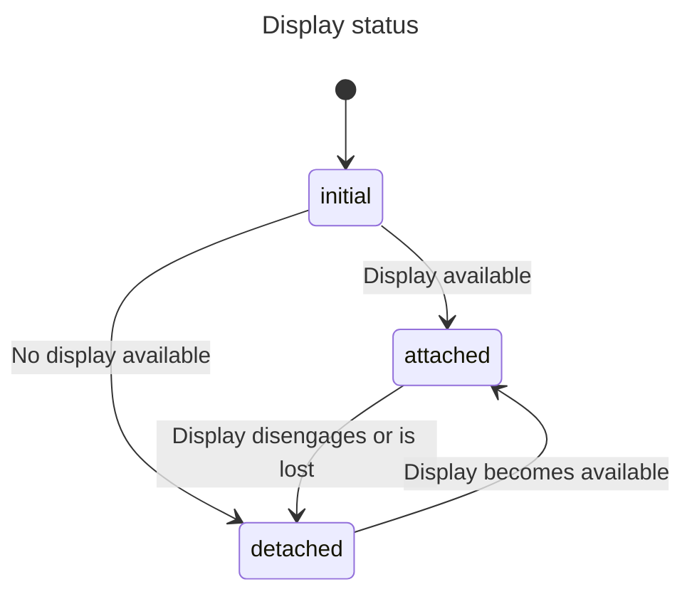
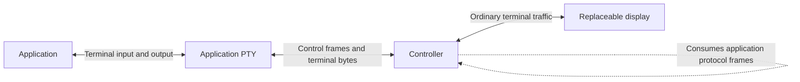
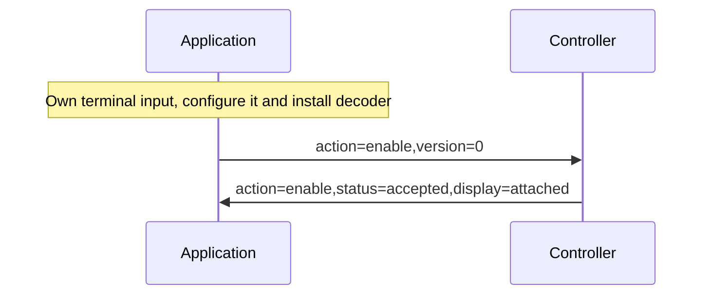
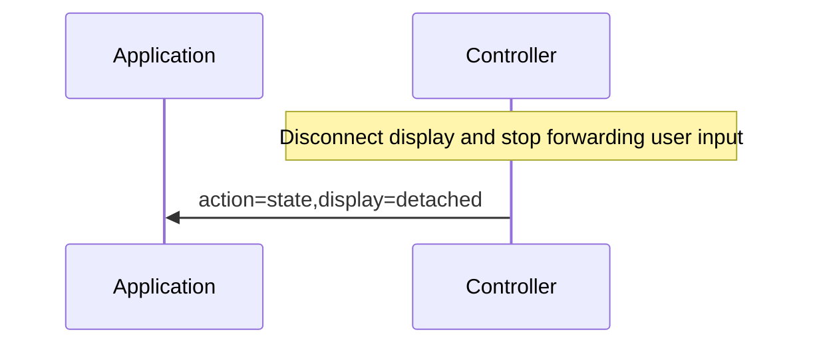
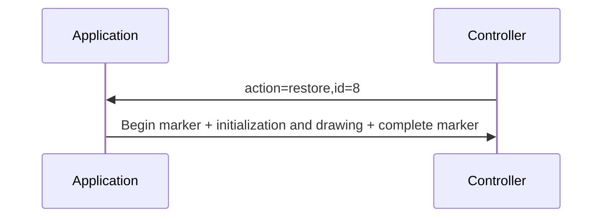
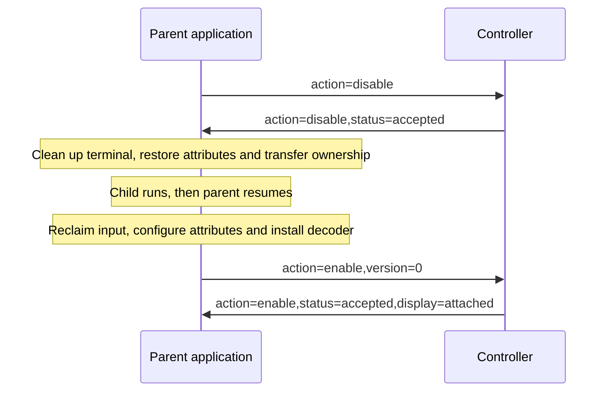
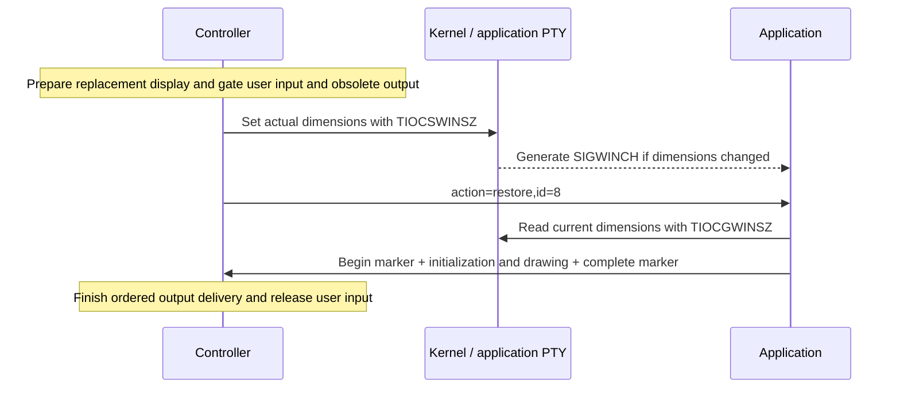

# Restore Display: experimental v0 specification

Status: **experimental and unregistered; minimal reference prototype available**.
Updated 2026-11-02.
Restore Display lets an application reconstruct its interface when a terminal
becomes available again. It is independent of Kittyplex and uses small ASCII
key/value messages. This specification replaces the earlier unimplemented draft;
there is no compatibility requirement with that draft.

The [demo and exerciser requirements](terminal-recovery-demo-spec.md) describe
reference integrations and tests. The [minimal reference](restore-display-demo.md)
implements the image demonstration and independent exerciser, with explicit lifecycle
and advanced-feature limitations. The [research document](terminal-recovery-protocol.md)
retains background and alternatives. No production detach implementation or
persistence strategy has been selected.

## 1. The application contract

An application that enables Restore Display promises to **reestablish the terminal
modes and resources it needs, then draw its current interface while preserving
application state and pending input**. This is more than an incremental refresh
or repaint. It does not require a saved terminal snapshot.

For example, a file manager restores its panels and active dialog; an editor
restores unsaved text and cursor positions. If the interface uses graphics, it
retransmits current image data and recreates placements. It must not assume that
images, colors or saved mode stacks from the old terminal still exist. If it
cannot meet this promise, it reports restoration unavailable.

MUST and MUST NOT state requirements; SHOULD describes a recommendation; MAY
permits optional behavior. V0 supports one display and one cooperating application
interface at a time. A **controller** owns the application PTY master and connects
it to a **display**, such as a terminal-emulator window. Keeping the process and
PTY alive is the controller's responsibility, not a service provided by this
protocol. An **enabled application** has opted in to receiving protocol input.

### Display status



- **initial**: The application has not yet established the display status through
  an accepted enable response. This is a local starting condition, never a wire
  value or a state to return to. An unsupported application may remain here
  without participating.
- **attached**: A display is available. Its contents may still need restoration;
  this status alone does not mean drawing or user input can resume.
- **detached**: No display is available. The process and its application data
  survive, and background computation may continue while drawing is paused.

The enable response establishes the first status. A detached notification reports
loss; a restore request establishes attached status. There is no separate attached
notification or display-status query. Restoration is an operation, not another
display state. Track participation and the restore request separately. Failure
leaves the status attached while a display remains available. Loss changes it to
detached and invalidates the controller's current attempt.

Disable, shutdown and child handoff end participation, not display availability.
They do not transition back to initial. A disabled participant's last-known status
is no longer authoritative; a later enable acceptance supplies the current status.

### Quickstart for application developers

1. While owning terminal input, configure compatible input settings and install
   the decoder, then enable support and consume the response.
2. On a detached notification, pause drawing and display queries when practical;
   preserve application data and pending input.
3. On a restore request, initialize the terminal and redraw the current interface.
   An adapter writes begin and complete markers around that output, or reports
   unavailable if restoration cannot finish.
4. Before relinquishing terminal input, disable support and consume its
   acknowledgement, then perform normal terminal cleanup and handoff.

The adapter handles framing, request IDs and output serialization. Application
code supplies a detach hook and a restore callback at safe UI execution points.
The callback may finish before a newer request is serviced; it need not support
immediate cancellation. [PTY integration](#9-pty-integration) defines the ordering
of input setup, resize and signal handling around these exchanges.



The controller consumes protocol frames and forwards unrelated terminal traffic.
The application recognizes protocol input before keybinding dispatch, including
in dialogs, search and terminal-query waits. Neither side maintains an extra
terminal screen model just to implement this protocol.

## 2. Escape sequence

All messages use this experimental vendor DCS string:

```text
ESC P @restore-display;action=ACTION[,key=value...] ESC \
```

Spaces in the framing notation are explanatory; none are transmitted.
For example, a restore request is the exact bytes:

```text
\x1bP@restore-display;action=restore,id=7\x1b\\
```

In this worked request, `action=restore` asks the application to reconstruct the
display, and `id=7` identifies this particular attempt. The application echoes
`id=7` in its `action=begin` and `action=complete` responses, or in an
`action=unavailable` response if it cannot finish. `ESC P` starts the DCS string,
`@restore-display;` selects this protocol, commas separate fields, and `ESC \`
ends the message. The `\x1b` notation above represents one escape byte, not four
literal characters. No spaces or newline are sent.

Only the seven-bit introducer `ESC P` and terminator `ESC \` are accepted. BEL
and eight-bit C1 forms are not used. The namespace is unregistered; implementations
must explicitly enable experimental v0 support. Graphics use their own terminal
protocol, not a payload inside Restore Display.

### Fields

| Key | Value |
| --- | --- |
| `action` | Required operation name from section 3 |
| `version` | Requested protocol version; `0` in the enable request |
| `id` | Transaction number, assigned by the controller |
| `status` | Enable/disable result: `accepted` or `unavailable`, as specified below |
| `display` | Display status: `attached` or `detached` |

Fields may be in any order. Keys are nonempty words of lowercase ASCII letters.
Values are nonempty ASCII words containing only letters, digits, `.`, `_`, `+`
or `-`. Known numeric fields use unsigned decimal with no leading zeros except
the value `0` itself.
Transaction numbers are `1..4294967295`. Empty fields, whitespace, repeated keys,
leading/trailing commas and invalid known values make a message invalid. Unknown
keys are ignored, allowing small future extensions. Unknown actions and invalid
messages are ignored; no generic error-response machinery is defined.

A frame, including introducer and terminator, must not exceed 512 bytes. Senders
serialize complete frames with their other terminal writes. Receivers handle
fragmented and adjacent frames, bound storage, and recognize this namespace only
at a control-string boundary, never inside another OSC/DCS/APC payload. Unrelated
strings pass through unchanged without unbounded buffering.

After recognizing the namespace, a receiver consumes the frame rather than
passing it to a display or keymap. An invalid/oversized frame is discarded through
its terminator. CAN (`0x18`) or SUB (`0x1a`) cancels it immediately. An ESC not
followed by `\` cancels it and is reconsidered as the next control introducer.
Incomplete frames remain bounded until completion, cancellation or connection
closure.

## 3. Operations

A = application; C = controller. Fields shown in the table are required.
There are no other required fields. Responses use the same action as their
request except restoration start/completion and unavailable notifications.

| Direction | Fields | Meaning |
| --- | --- | --- |
| A -> C | `action=enable,version=0` | Enable v0 participation for the current interface if supported |
| C -> A | `action=enable,status=accepted,display=detached` or `action=enable,status=accepted,display=attached` | Accepted; includes current display state |
| C -> A | `action=enable,status=unavailable` | Participation unavailable; no notifications enabled |
| A -> C | `action=disable` | Disable participation before shutdown or another reader takes over |
| C -> A | `action=disable,status=accepted` | Disabled; final protocol input for this participation |
| C -> A | `action=state,display=detached` | Display has detached or been lost |
| C -> A | `action=restore,id=N` | Display is attached; restore it |
| A -> C | `action=begin,id=N` | Start of restoration output; earlier output is obsolete |
| A -> C | `action=complete,id=N` | Restoration output has been written to the PTY in order |
| A -> C | `action=unavailable,id=N` | Cannot complete this restoration |

The controller never sends unsolicited input to a participant that has not
enabled the protocol. The application initiates a versioned enable request,
which combines support discovery and opt-in. It installs its decoder and prevents
terminal echo/line-discipline transformations before enabling.
An attached application draws normally after enable acceptance; a detached one
waits for a restore request. Unsupported controllers need not respond; absence
of a response means support was not established, not that restoration is impossible.

Application support is deliberately a single promise. It includes resources used
by that interface, not separate per-feature coverage flags. Screen dimensions
come from the existing terminal-size mechanism. Existing graphics, keyboard and
other terminal protocols supply their own capability queries when a display is
available. The controller updates actual PTY geometry before requesting restore.
The application may probe terminal features after its start marker, or report
unavailable rather than silently claim complete restoration with missing content.

The controller recognizes one current restore request. It assigns increasing
transaction numbers for the PTY lifetime, never reusing them, and ends
participation before exhausting the range. Only responses matching that current
request can advance restoration or release user input. An adapter runs one restore
callback at a time and may retain the newest pending request, as described in
[section 7](#7-unexpected-loss-and-display-changes). There are no other IDs, tokens
or per-message counters.

## 4. Discovery and startup



The application requests the version it implements; acceptance confirms that
version without a separate discovery exchange or final acknowledgement. The
controller must not accept an unsupported version. It may refuse with
`action=enable,status=unavailable`; an unsupported controller may remain silent.
Refusal or silence leaves support unestablished and ordinary operation available.

The accepted response reports `display=attached` or `display=detached`. The former
allows normal initial drawing; the latter requires waiting for a restore request.
The controller serializes acceptance before any subsequent protocol events on
the same input stream, so availability changes after acceptance arrive in order.
No new participation is enabled by a refused request. A repeated enable while
already enabled is refused and does not replace the active interface.
The controller never probes an unknown reader with unsolicited protocol input.

Timeouts are local implementation policy, not fields in the protocol. Before
handing input to another reader, an application must resolve any outstanding
negotiation, including a late acceptance, through disable acknowledgement or
controller-confirmed revocation. Merely waiting a short time cannot prove that
no late terminal response will arrive. A decoder remains installed while resolving
that uncertainty. The exerciser explicitly tests a silent unsupported controller.

## 5. Display disengagement



Intentional detachment and unexpected display loss use this same notification.
The controller invalidates the current restore attempt and stops routing input
from the detached display. It keeps the application PTY alive and continues
reading application output and processing protocol frames.

The application pauses drawing and new display queries/effects when it can process
the event, and reconciles outstanding terminal queries. Application data and
pending input survive; computation may continue. The notification is not an
acknowledgement that drawing has stopped, and a callback or write already in
progress may finish. The controller handles that remaining output according to
its declared retention/discard policy.

V0 does not promise delivery of the final updates to the old display or preservation
of terminal history. It promises restoration of the current application interface.
The prepare/ready handshake for graceful disengagement remains a
[research alternative](terminal-recovery-protocol.md#intentional-disengagement-and-unexpected-loss),
not a v0 operation or a required capability.

## 6. Restore display



The response arrow groups an ordered stream, not a single message or write. Its
markers are `action=begin,id=8` and `action=complete,id=8`; the bytes between them
use ordinary terminal protocols, including graphics. No whole-screen buffer or
acknowledgement of each marker is required. Terminal queries and replies may occur
within the restoration.

Before requesting restore, the controller prepares the display, gates user input
and obsolete output, then updates actual PTY dimensions. The
[detailed ordering](#resize-and-restoration-order) includes the resulting resize
signal. The restore request establishes attached status without implying that
restoration has finished.

At a safe execution point the application finishes or stops older rendering,
writes pending earlier output to the PTY and finishes partial control strings.
It then writes begin, initializes modes/resources, draws its current interface,
and writes complete after all that output. The adapter serializes this stream
with other terminal writes and submits buffered bytes through complete to the
PTY. Scheduling a future redraw is insufficient. Here, writing pending output
means preserving its order; it does not mean discarding it with `tcflush()`.

The controller suppresses obsolete presentation output until the matching begin
marker, then forwards restoration output in order. Begin is needed because old
bytes may still be buffered in the application. Complete marks the end of the
restoration; after it, the controller finishes ordered delivery before allowing
normal interaction. Terminal replies needed by restoration remain deliverable
while user input is gated.

```text
Application output:   obsolete bytes | action=begin,id=8 | initialization + drawing | action=complete,id=8 | live output
Replacement display:     suppressed  |     consumed      |          forwarded       |       consumed       | forwarded
```

The application may report unavailable before or after the start marker using
`action=unavailable,id=8`. A failed or timed-out attempt leaves restoration visibly
incomplete and user input gated. A retry gets a new transaction number; only its
start marker reopens restoration output. Old completion messages cannot release input.

Restore means the same operation for an empty or previously used display:
reestablish owned modes/resources and redraw. Restoring saved stacks must include
the application-owned baseline needed for later return to a parent, not just the
current top value. A participant unable to do that must report unavailable.
Byte-perfect continuation of an intact retained view is a separate controller
mechanism, not another mode or capability in this protocol.

Completion marks the application's output boundary. The controller must still
finish ordered delivery; neither step proves that the terminal has rendered a
frame. After reattachment, test subsequent input and drawing, not just a picture.

## 7. Unexpected loss and display changes

On unexpected loss, use the [detached notification](#5-display-disengagement).
When a display becomes available, use the [restore exchange](#6-restore-display).
The controller detects failure; application-facing heartbeats and leases are not
part of v0. Loss invalidates its current attempt immediately, so a delayed response
cannot revive it. This does not require an application callback to stop instantly.

If resize or replacement requires another restoration, update geometry in the
specified order and issue a new request ID. The controller closes the presentation
gate until the new matching begin marker and ignores earlier completion/failure
responses. It must not let an earlier attempt release user input.

The adapter MAY finish the running callback before handling the newer request.
As requests are decoded, retain only the newest pending restore; do not start
concurrent callbacks. At the next safe point, process pending display events and
service that request if the display is still attached. A detached notification
clears pending restores received before it; a later restore establishes attached
status again. Duplicate or older request IDs are ignored. Any output or completion
from a superseded callback remains associated with its original ID.

This permits ordinary render functions without cancellation points in every
output chunk. A callback that waits for terminal replies still needs the event
loop/decoder to handle loss and query failure. Ordinary resize while attached
uses existing terminal mechanisms and must serialize with restoration drawing.

## 8. Handoff and shutdown



Before acknowledging disable, the controller cancels the pending transaction,
stops new events and serializes earlier input. The parent consumes the
acknowledgement before handing input to a child. The child may opt in separately
or remain unsupported. When the parent resumes, it uses the same versioned enable
exchange as startup, drawing normally if attached or waiting for restore if
detached. Participation ends on disable; last-known display status is retained.

Disable is idempotent: the controller acknowledges it even if participation has
already ended. This responds to an application request rather than notifying an
unknown reader. Disable acknowledgement is the last protocol input for that
participation. The application keeps decoding through it, discards cancelled
transaction events, and drains/reconciles earlier terminal replies before
transferring input. Only then may it clean up terminal modes, restore appropriate
terminal attributes and transfer foreground ownership where required. On return,
it reclaims input ownership and configures the decoder/input settings before
enabling again. Normal shutdown uses the same disable exchange and cleanup.
Applications can start or shut down while detached: enable reports
`display=detached`, and disable still works without a display.

If restoration fails or times out, display status remains attached while the
display is available, but user input stays gated until a new restore, disable or
explicit fallback resolves the attempt. Only one cooperating interface reads
input at a time; process names or shared foreground groups do not establish that.
The controller must revoke participation on known process death or invalidation.
An in-band protocol cannot atomically detect arbitrary uncooperative exec/reader
takeover or retract input already delivered. Integrations must document their
lifecycle monitoring and cooperate with handoff, rather than claim universal
unmodified-shell safety. This protocol is not an authentication boundary.

## 9. PTY integration

### Input settings and output ownership

Before enabling, the application configures noncanonical, non-echoing input and
installs its decoder. Its terminal settings must let protocol bytes reach that
decoder without transformation or consumption as special characters. Keep
compatible settings until disable acknowledgement. The application owns these
settings; attaching a display does not require the controller to reset the slave
PTY's termios or recreate the PTY. See [terminal attributes](https://man7.org/linux/man-pages/man3/termios.3.html).

All writers belonging to the cooperating interface, including stderr on the same
PTY, must serialize with the markers. Uncontrolled background writers can interleave
bytes; the protocol does not identify their origin or repair that interference.

### Resize and restoration order



The ioctl arrows are operating-system calls; only the restore request and marked
response use Restore Display. The dashed arrow shows signal generation, not when
the application handles it. Linux sends SIGWINCH to the foreground process group
when dimensions change. Gate obsolete output before TIOCSWINSZ because an existing
resize handler may draw immediately. The restore callback reads current dimensions
without depending on that handler having run. Reattachment at unchanged dimensions
still requires restore. See [window-size operations](https://man7.org/linux/man-pages/man2/TIOCSWINSZ.2const.html).

Serialize resize-driven drawing with the restore callback. A delayed SIGWINCH
handler must not interleave incremental writes with restoration. Handle UI work
at a safe execution point rather than drawing asynchronously from the signal
handler. The controller does not send an extra SIGWINCH as a substitute for restore.

### Output queues, replies and flow control

Writing pending application buffers means submitting their bytes to the PTY in
order. `tcflush()` discards queues, and `TCSAFLUSH` can discard unread input; neither
is an ordinary restoration step. `tcdrain()` supplies no acknowledgement that a
replacement emulator has drawn the screen. Preserve the marker boundaries instead.
See [terminal queue operations](https://man7.org/linux/man-pages/man3/termios.3.html).

User-input gating stops forwarding user interaction while leaving protocol input
and terminal replies needed by restoration operational. Continue consuming the
application PTY while detached and restoring: otherwise a blocked older write can
prevent the application from reaching the restore callback or emitting begin.

XOFF or `tcflow(TCOOFF)` also suspends the stream carrying application protocol
responses. V0 does not use output suspension to detach. If existing user flow
control stalls an attempt, report that condition; do not silently undo it. Continue
servicing the separate controller UI. [Flow-control semantics](https://man7.org/linux/man-pages/man3/termios.3.html)
explain why keeping the controller responsive alone cannot unblock that stream.

### Job control and disrupted streams

Display loss does not stop the process, change its foreground group or close the
application PTY. Normal shell/application job control owns `tcsetpgrp()`, suspension
and resumption. Cooperative suspension must arrange disable/acknowledgement before
relinquishing input, then restore compatible input handling before enabling again.
SIGCONT alone does not establish display availability or completion. An uncatchable
SIGSTOP cannot perform a cooperative handshake. See [foreground ownership](https://man7.org/linux/man-pages/man3/tcsetpgrp.3.html)
and [signals](https://man7.org/linux/man-pages/man7/signal.7.html).

Terminal-generated interrupt, quit and suspend signals can flush queues depending
on termios settings, and application/library cleanup may also discard queued bytes.
An adapter must document and test its handling of these operations. A disrupted
attempt is incomplete: invalidate it, keep user input gated and reject late
completion. Reestablish usable decoding and ownership before retrying or enabling
again; a timeout or state query cannot reconstruct missing bytes or prove a safe
handoff. V0 does not prescribe changing signal semantics or setting NOFLSH.

Linux [PTY packet mode](https://man7.org/linux/man-pages/man2/TIOCPKT.2const.html)
can report queue flushes and output stop/start events. A controller may use these
as disruption evidence, but they neither identify the application nor acknowledge
a redraw. Raw-mode and Readline/job-control integrations require separate evidence;
the protocol alone does not guarantee arbitrary suspension or queue-clearing safety.

## 10. Implementation rules and examples

Kittyplex implements explicit cooperative session-display detach/attach while its
carrier remains connected, using the same wire codec as the reference demo.
Its [interactive walkthrough](usage.md#try-the-image-demo-through-kittyplex) covers
launch, shortcut detachment, session listing and restoration into a fresh tab.
This integration does not add persistence after carrier loss or prove arbitrary
job-control/queue-flush recovery; the independent exerciser remains the broader
protocol fault-testing tool.

Controller policy handles deadlines, failure detection, buffering and fallback.
It must preserve the resources needed by a fallback before discarding them.
Failed restoration must not silently inject Ctrl-L or signals, replay old effects,
restart the application or terminate it. Raw PTY/control processing stays bounded
and responsive while detached; a fresh-restoration policy may drain obsolete
output without promising uninterrupted byte delivery.

User input is visibly rejected while detached/restoring rather than queued
for surprise execution. Previously delivered input is not replayed. Real terminal
replies and inserted protocol input are serialized without interleaving frames.
An outstanding query at loss must be cancelled/reconciled; stale replies must not
become keystrokes or answers to a new indistinguishable query. Fresh attachment
must not inherit replies from the discarded display. Clipboard writes, desktop
notifications and other one-time effects are not part of restoration.

Literal examples, with explanatory escape notation:

```text
Application -> Controller: \x1bP@restore-display;action=enable,version=0\x1b\\
Controller -> Application: \x1bP@restore-display;action=enable,status=accepted,display=attached\x1b\\
Controller -> Application: \x1bP@restore-display;action=restore,id=12\x1b\\
Application -> Controller: \x1bP@restore-display;action=begin,id=12\x1b\\
Application -> Controller: [ordinary terminal initialization, images and text]
Application -> Controller: \x1bP@restore-display;action=complete,id=12\x1b\\
```

Required parser/behavior tests include every frame split point, adjacent frames,
unknown keys/actions, invalid/repeated fields, the 512-byte bound, cancellation,
namespace text inside another control string, disabled participants, stale
transaction responses, completion before start, refusal, interrupted restoration
and acknowledged child handoff. A completion before start fails the transaction
and cannot release input. Unknown/invalid messages produce no generic error reply.

Framework adapters should isolate this small codec, schedule restoration below
keymaps at safe UI execution points, and expose application initialization/redraw
callbacks. Do not draw asynchronously from a signal handler. Passing protocol
checks is distinct from proving graphics, terminal modes and interactions work.
See the [exerciser](terminal-recovery-demo-spec.md#5-protocol-exerciser).

Existing protocol patterns, not an allocation or endorsement of Restore Display:
[Kitty graphics](https://sw.kovidgoyal.net/kitty/graphics-protocol/),
[notification metadata](https://sw.kovidgoyal.net/kitty/desktop-notifications/),
[keyboard negotiation](https://sw.kovidgoyal.net/kitty/keyboard-protocol/), and
[Linux PTY behavior](https://man7.org/linux/man-pages/man7/pty.7.html).
