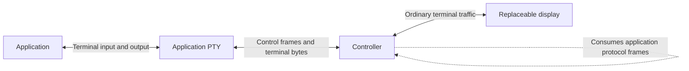
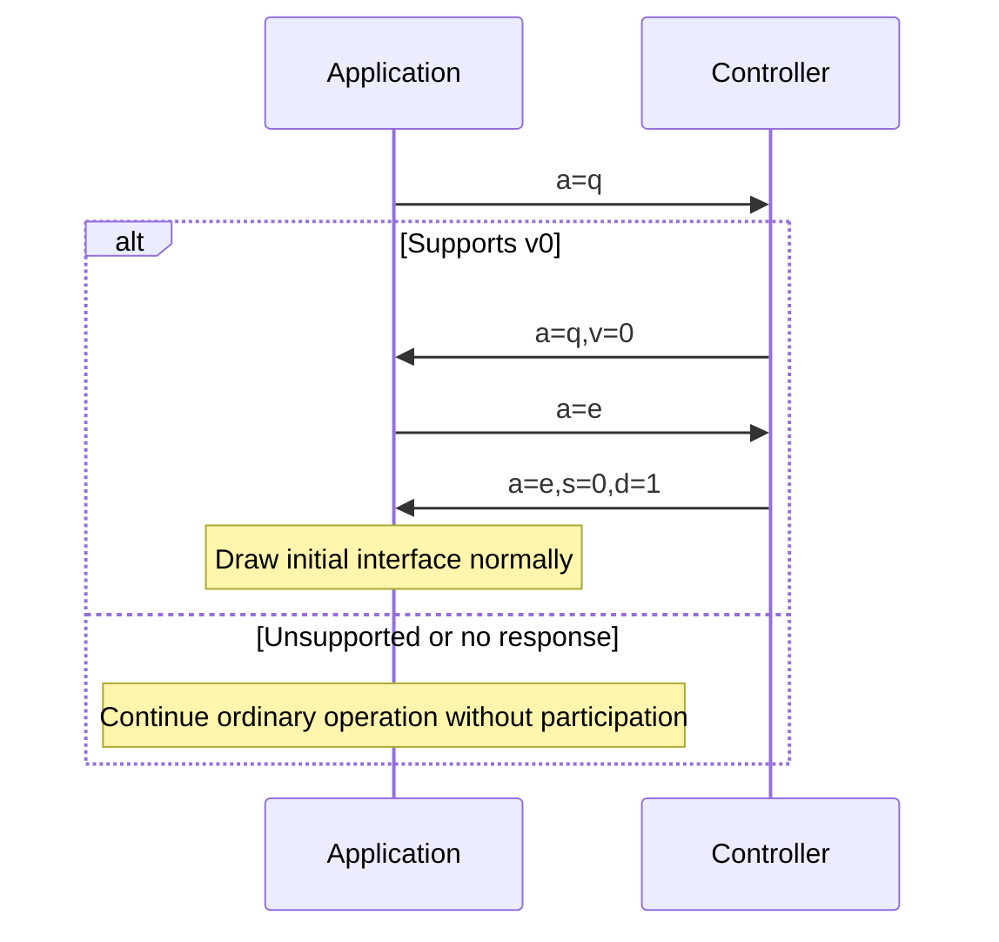
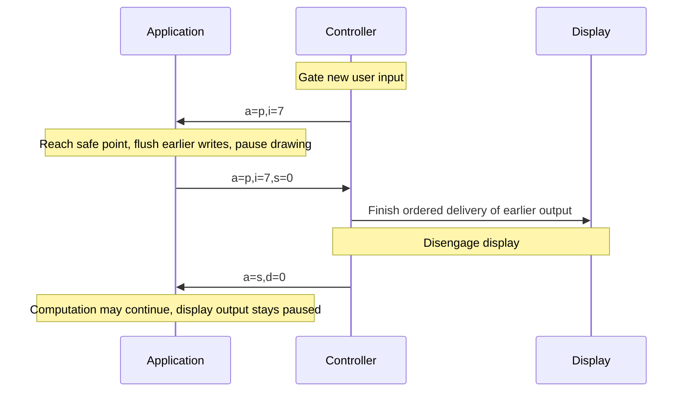
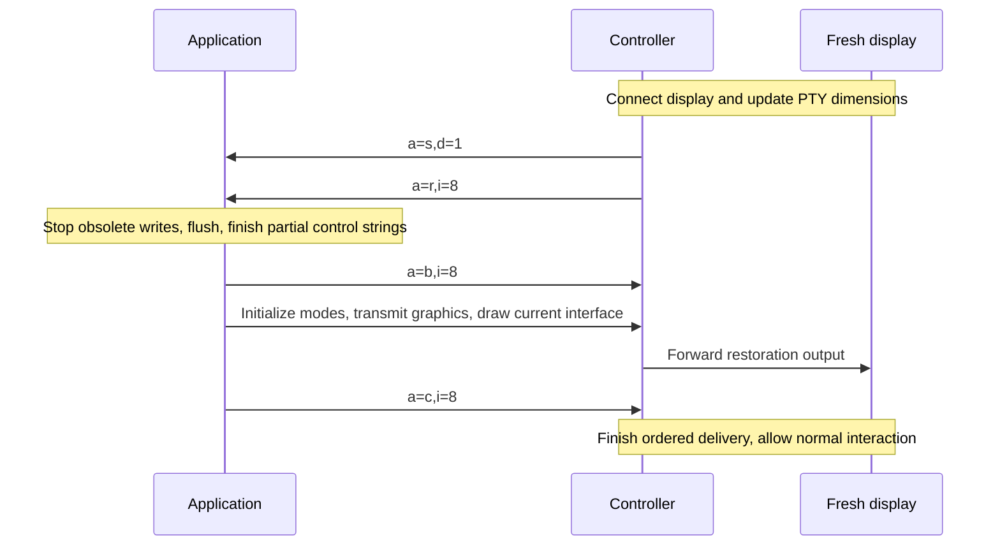
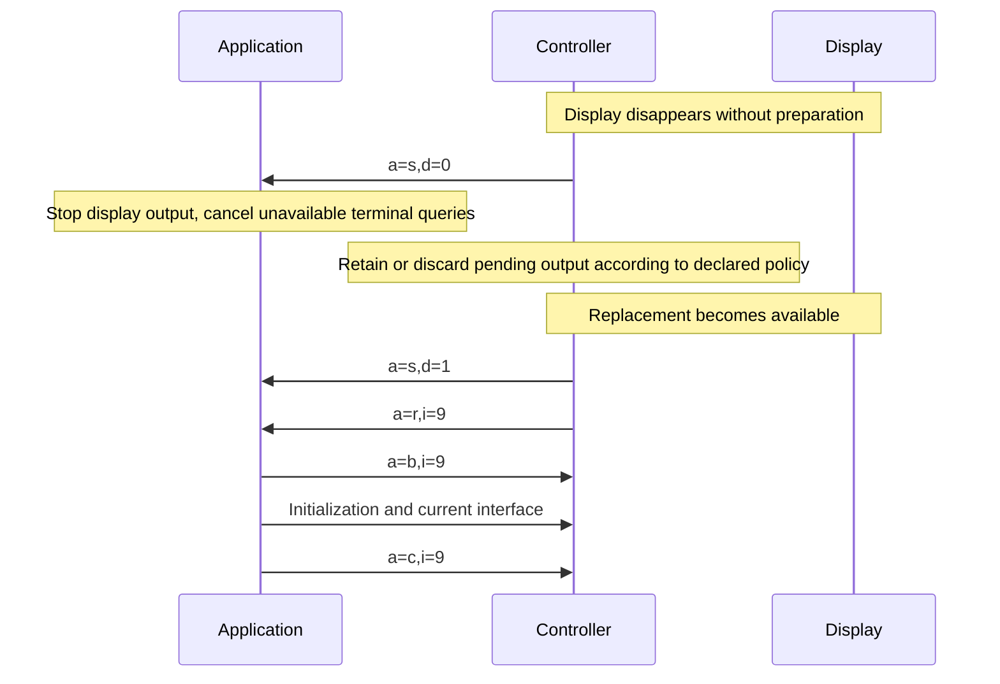
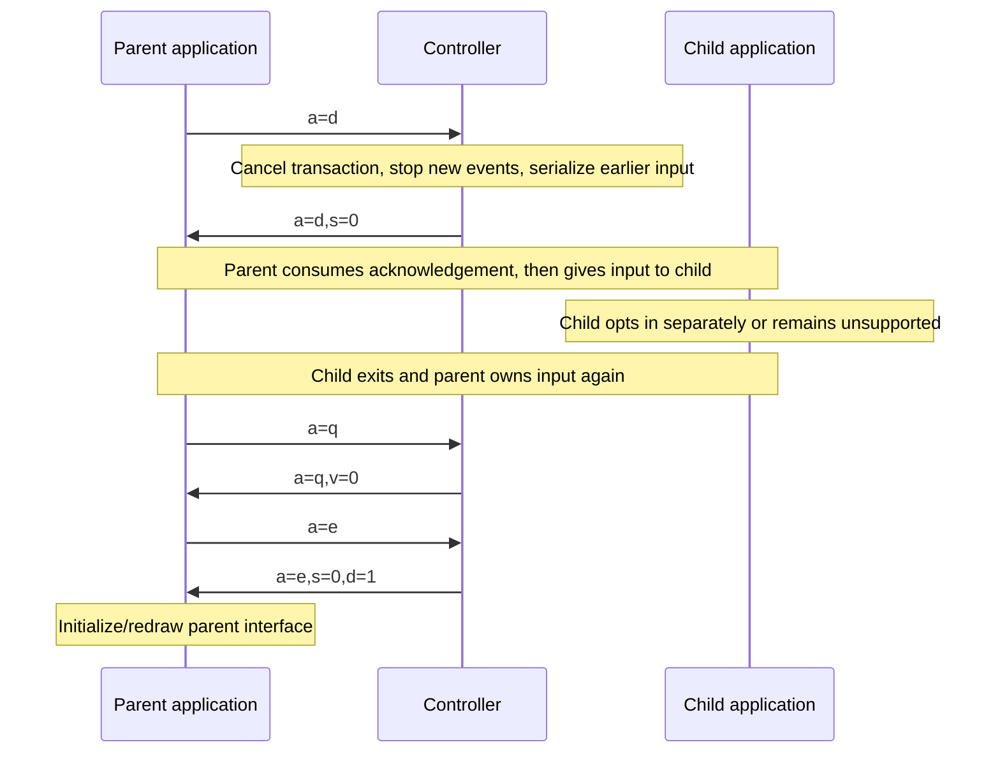
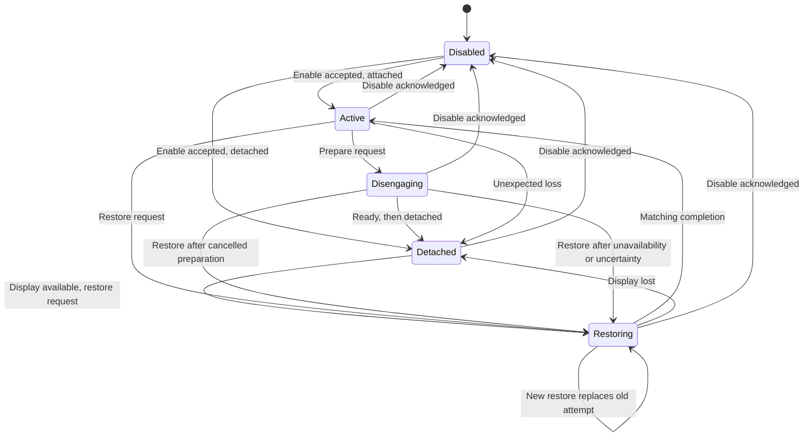

# Restore Display: experimental v0 specification

Status: **experimental, unregistered and not implemented**. Updated 2026-11-02.
Restore Display lets an application reconstruct its interface when a terminal
becomes available again. It is independent of Kittyplex and requires no JSON or
binary payload encoding. This specification replaces the earlier JSON-based draft;
there is no compatibility requirement with that unimplemented draft.

The [demo and exerciser requirements](terminal-recovery-demo-spec.md) describe
reference integrations and tests. The [research document](terminal-recovery-protocol.md)
retains background and alternatives. No production detach implementation or
persistence strategy has been selected.

## 1. The application contract

An application that enables Restore Display promises to **reestablish the terminal
modes and resources it needs, then draw its current interface while preserving
application state and pending input**. This is more than an incremental refresh
or repaint. It does not require a saved terminal snapshot.

For example, a file manager restores its panels and active dialog; an editor
restores unsaved text and cursor positions. If the interface uses graphics, it
retransmits current image data and recreates placements. It must not assume that
images, colors or saved mode stacks from the old terminal still exist. If it
cannot meet this promise, it reports restoration unavailable.

MUST and MUST NOT state requirements; SHOULD describes a recommendation; MAY
permits optional behavior. V0 supports one display and one cooperating application
interface at a time. A **controller** owns the application PTY master and connects
it to a **display**, such as a terminal-emulator window. Keeping the process and
PTY alive is the controller's responsibility, not a service provided by this
protocol. An **enabled application** has opted in to receiving protocol input.



The controller consumes protocol frames and forwards unrelated terminal traffic.
The application recognizes protocol input before keybinding dispatch, including
in dialogs, search and terminal-query waits. Neither side maintains an extra
terminal screen model just to implement this protocol.

## 2. Escape sequence

All messages use this experimental vendor DCS string:

```text
ESC P @restore-display; a=ACTION[,key=value...] ESC \
└─DCS─┘ └─namespace───┘ └────ASCII fields──────┘ └─ST─┘
```

Spaces and alignment in the diagram are explanatory; none are transmitted.
For example, a restore request is the exact bytes:

```text
\x1bP@restore-display;a=r,i=7\x1b\\
```

Only the seven-bit introducer `ESC P` and terminator `ESC \` are accepted. BEL
and eight-bit C1 forms are not used. The namespace is unregistered; implementations
must explicitly enable experimental v0 support. Graphics use their own terminal
protocol, not a payload inside Restore Display.

### Fields

| Key | Value |
| --- | --- |
| `a` | Required action letter from section 3 |
| `v` | Protocol version; `0` in the discovery response |
| `i` | Transaction number, assigned by the controller |
| `s` | Status: `0` accepted/ready; `1` unavailable |
| `d` | Display state: `0` detached; `1` attached |

Fields may be in any order. Keys are single ASCII letters. Values are nonempty
ASCII words containing only letters, digits, `.`, `_`, `+` or `-`. Known numeric
fields use unsigned decimal with no leading zeros except the value `0` itself.
Transaction numbers are `1..4294967295`. Empty fields, whitespace, repeated keys,
leading/trailing commas and invalid known values make a message invalid. Unknown
keys are ignored, allowing small future extensions. Unknown actions and invalid
messages are ignored; no generic error-response machinery is defined.

A frame, including introducer and terminator, must not exceed 512 bytes. Senders
serialize complete frames with their other terminal writes. Receivers handle
fragmented and adjacent frames, bound storage, and recognize this namespace only
at a control-string boundary, never inside another OSC/DCS/APC payload. Unrelated
strings pass through unchanged without unbounded buffering.

After recognizing the namespace, a receiver consumes the frame rather than
passing it to a display or keymap. An invalid/oversized frame is discarded through
its terminator. CAN (`0x18`) or SUB (`0x1a`) cancels it immediately. An ESC not
followed by `\` cancels it and is reconsidered as the next control introducer.
Incomplete frames remain bounded until completion, cancellation or connection
closure. No JSON parser, base64 decoder or nested object model is required.

## 3. Operations

A = application; C = controller. Fields shown in the table are required.
There are no other required fields. Responses use the same action as their
request except restoration start/completion and unavailable notifications.

| Direction | Fields | Meaning |
| --- | --- | --- |
| A -> C | `a=q` | Does this controller support Restore Display? |
| C -> A | `a=q,v=0` | It supports v0 |
| A -> C | `a=e` | Enable participation for the current interface |
| C -> A | `a=e,s=0,d=0` or `a=e,s=0,d=1` | Accepted; includes current display state |
| C -> A | `a=e,s=1` | Participation unavailable; no notifications enabled |
| A -> C | `a=d` | Disable participation before shutdown or another reader takes over |
| C -> A | `a=d,s=0` | Disabled; final protocol input for this participation |
| A -> C | `a=s` | Query current display state while enabled |
| C -> A | `a=s,d=0` or `a=s,d=1` | State response or unsolicited state notification |
| C -> A | `a=p,i=N` | Prepare to disengage the display |
| A -> C | `a=p,i=N,s=0` | Ready: earlier output flushed and new drawing paused |
| C -> A | `a=r,i=N` | Restore the available display |
| A -> C | `a=b,i=N` | Start of restoration output; earlier output is obsolete |
| A -> C | `a=c,i=N` | Restoration output complete and flushed |
| A -> C | `a=f,i=N,s=1` | Cannot complete this disengagement/restoration |

The controller never sends unsolicited input to a participant that has not
enabled the protocol. Discovery is application-initiated; a discovery response
alone does not enable notifications. The application installs its decoder and
prevents terminal echo/line-discipline transformations before querying/enabling.
An attached application draws normally after enable acceptance; a detached one
waits for a restore request. Unsupported controllers need not respond; absence
of a response means support was not established, not that restoration is impossible.

Application support is deliberately a single promise. It includes resources used
by that interface, not separate per-feature coverage flags. Screen dimensions
come from the existing terminal-size mechanism. Existing graphics, keyboard and
other terminal protocols supply their own capability queries when a display is
available. The controller updates actual PTY geometry before requesting restore.
The application may probe terminal features after its start marker, or report
unavailable rather than silently claim complete restoration with missing content.

Only one disengagement/restoration transaction is outstanding. The controller
uses increasing transaction numbers for the PTY lifetime, never reusing them;
it ends participation before exhausting the range. A new restore request replaces
an earlier transaction. The application stops the old drawing path before starting
the replacement; old requests are ignored. Only responses matching the current
transaction can change controller state. There are no other IDs, tokens, global
attachment generations or per-message counters.

## 4. Discovery and startup



The controller must not send state/events before acceptance. The application does
not enable an unknown version. An enable refusal leaves it disabled. A repeated
enable while already enabled is refused and does not replace the active interface.
State queries are answered only while enabled. Unknown/disabled input is not a
place for controller probing.

Timeouts are local implementation policy, not fields in the protocol. Before
handing input to another reader, an application must resolve any outstanding
negotiation, including a late acceptance, through disable acknowledgement or
controller-confirmed revocation. Merely waiting a short time cannot prove that
no late terminal response will arrive. A decoder remains installed while resolving
that uncertainty. The exerciser explicitly tests a silent unsupported controller.

## 5. Display disengagement



Readiness is an output barrier, not a request to freeze the process. After it,
only protocol output is permitted until restoration. Pending input and application
data remain intact. An application that cannot prepare sends `a=f,i=7,s=1`.
The controller cannot claim graceful disengagement without the matching readiness
response. On refusal or timeout it may keep the display or explicitly force loss;
that policy belongs to the controller. Before resuming user interaction after an
uncertain preparation, restore the display, since a late readiness response may
have paused drawing.

## 6. Restore display



A state notification that the display is attached does not itself resume drawing.
The application waits for restore. Start and completion markers share the same
serialized output path as drawing. The controller suppresses obsolete presentation
output to the replacement until the matching start marker, then forwards the
restoration output in order. The application emits completion only after flushing
all initialization and drawing output, never merely scheduling it.

```text
Application output:  obsolete bytes | a=b,i=8 | initialization + drawing | a=c,i=8 | live output
Replacement display:    suppressed  | consumed|          forwarded       | consumed| forwarded
```

The application may report unavailable before or after the start marker using
`a=f,i=8,s=1`. A failed or timed-out attempt leaves restoration visibly incomplete
and user input gated. A retry gets a new transaction number; only its start marker
reopens restoration output. Old completion messages cannot release input.

Restore means the same operation for an empty or previously used display:
reestablish owned modes/resources and redraw. Restoring saved stacks must include
the application-owned baseline needed for later return to a parent, not just the
current top value. A participant unable to do that must report unavailable.
Byte-perfect continuation of an intact retained view is a separate controller
mechanism, not another mode or capability in this protocol.

Completion establishes application output completion and ordered delivery. It
is not an acknowledgement that the terminal parsed everything or rendered a
frame. After reattachment, test subsequent input and drawing, not just a picture.

## 7. Unexpected loss and display changes



An application must support restoration without an earlier preparation handshake.
Detached notification causes it to stop new display queries/effects and drawing
when it can process the event. There is no extra quiescence acknowledgement for
unexpected loss; the later restoration start marker provides the required output
boundary. Delivery of detached notification alone does not prove drawing stopped.

A controller detects display failure and reports state; application-facing
heartbeats/leases are not part of v0. The application may query state after
uncertainty. State messages are ordered on the same input stream. A display loss
cancels the controller's pending transaction, so an old response cannot revive it.

If resize or replacement occurs during restoration, update actual PTY geometry
and issue a new restore transaction. The application serializes cancellation of
the old renderer with starting the new one. Ordinary resize handling while active
can continue to use existing terminal mechanisms. A restoration failure must not
be mistaken for successful ordinary resize.

## 8. Handoff, shutdown and state



Disable is idempotent: the controller acknowledges it even if participation has
already ended. This responds to an application request rather than notifying an
unknown reader. Disable acknowledgement is the last protocol input for that
participation. The
application keeps decoding through it, discards cancelled transaction events,
and drains/reconciles earlier terminal replies before transferring input. Normal
shutdown uses the same disable exchange; no separate goodbye operation is needed.
Applications can start or shut down while detached: enable reports `d=0`, and
disable still works without a display.



While restoring, unavailable/timeout leaves input gated in that state until a new
restore, disable or explicit fallback. After uncertain disengagement, a restore
is required before assuming normal state. Only one cooperating interface reads
input at a time; process names or shared foreground groups do not establish that.
The controller must revoke participation on known process death or invalidation.
An in-band protocol cannot atomically detect arbitrary uncooperative exec/reader
takeover or retract input already delivered. Integrations must document their
lifecycle monitoring and cooperate with handoff, rather than claim universal
unmodified-shell safety. This protocol is not an authentication boundary.

## 9. Implementation rules and examples

Controller policy handles deadlines, failure detection, buffering and fallback.
It must preserve the resources needed by a fallback before discarding them.
Failed restoration must not silently inject Ctrl-L or signals, replay old effects,
restart the application or terminate it. Raw PTY/control processing stays bounded
and responsive while detached; a fresh-restoration policy may drain obsolete
output without promising uninterrupted byte delivery.

User input is visibly rejected while disengaging/restoring rather than queued
for surprise execution. Previously delivered input is not replayed. Real terminal
replies and inserted protocol input are serialized without interleaving frames.
An outstanding query at loss must be cancelled/reconciled; stale replies must not
become keystrokes or answers to a new indistinguishable query. Fresh attachment
must not inherit replies from the discarded display. Clipboard writes, desktop
notifications and other one-time effects are not part of restoration.

Literal examples, with explanatory escape notation:

```text
Application -> Controller: \x1bP@restore-display;a=q\x1b\\
Controller -> Application: \x1bP@restore-display;a=q,v=0\x1b\\
Application -> Controller: \x1bP@restore-display;a=e\x1b\\
Controller -> Application: \x1bP@restore-display;a=e,s=0,d=1\x1b\\
Controller -> Application: \x1bP@restore-display;a=r,i=12\x1b\\
Application -> Controller: \x1bP@restore-display;a=b,i=12\x1b\\
Application -> Controller: [ordinary terminal initialization, images and text]
Application -> Controller: \x1bP@restore-display;a=c,i=12\x1b\\
```

Required parser/behavior tests include every frame split point, adjacent frames,
unknown keys/actions, invalid/repeated fields, the 512-byte bound, cancellation,
namespace text inside another control string, disabled participants, stale
transaction responses, completion before start, refusal, interrupted restoration
and acknowledged child handoff. A completion before start fails the transaction
and cannot release input. Unknown/invalid messages produce no generic error reply.

Framework adapters should isolate this small codec, schedule restoration below
keymaps at safe UI execution points, and expose application initialization/redraw
callbacks. Do not draw asynchronously from a signal handler. Passing protocol
checks is distinct from proving graphics, terminal modes and interactions work.
See the [exerciser](terminal-recovery-demo-spec.md#5-protocol-exerciser).

Existing protocol patterns, not an allocation or endorsement of Restore Display:
[Kitty graphics](https://sw.kovidgoyal.net/kitty/graphics-protocol/),
[notification metadata](https://sw.kovidgoyal.net/kitty/desktop-notifications/),
[keyboard negotiation](https://sw.kovidgoyal.net/kitty/keyboard-protocol/), and
[Linux PTY behavior](https://man7.org/linux/man-pages/man7/pty.7.html).
